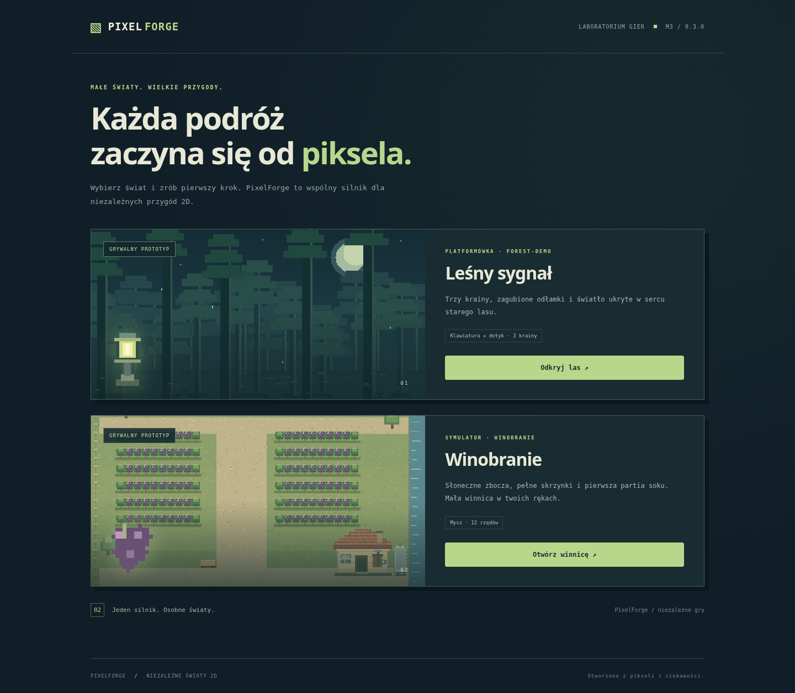
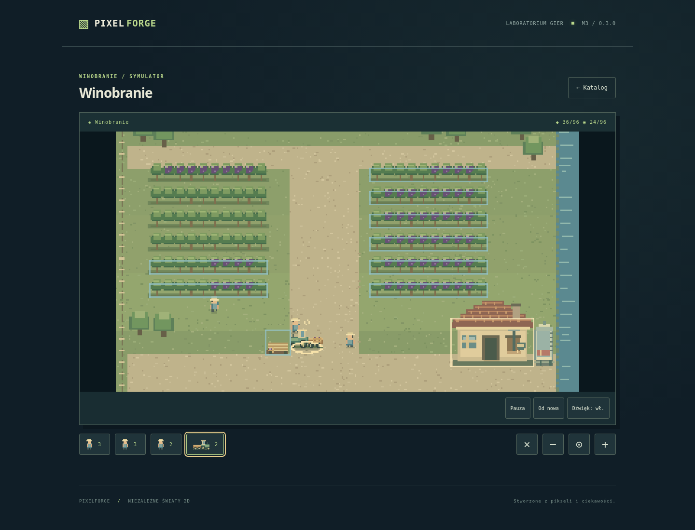

# M3 — TopDown Simulator i Winobranie

Data: 2026-11-13. Gałąź: `feature/m3-winobranie`.

## Zakres

Drugi gatunek działa przez wspólny `EngineHost`, Boot/Preload/Title, loader,
audio, katalog, pauzę i interfejs HTML. Dodano czysty model symulacji, A* na
siatce, rezerwacje źródeł, kolejki, anulowanie, magazyny i receptury.
Pojazd wymaga drogi i prześwitu 3×3; nie przejeżdża przez obiekty.

Winobranie dostarcza konfigurację i oryginalne grafiki: 12 rzędów, trzech
pracowników, traktor z przyczepą, plac, winiarnia z prasą i zbiornik. Wszystkie
parametry, zasoby i receptura są danymi gry. Silnik nie importuje gier i nie
rozpoznaje nazw tytułów. Nie dodano bibliotek ani usług.

W świecie widać ubywające grona, skrzynki pracowników i placu, ładunek przyczepy,
pracę prasy i przyrost soku. Sterowanie myszą obejmuje wybór, zlecenia,
przesuwanie kamery i zoom. Przyciski ikonowe zapewniają wybór jednostek,
anulowanie i zoom także bez kółka. Brak pisanych podpowiedzi gameplayowych.

Zapis v1 symulatora zawiera pozycje, bieżące trasy i fazy, kolejki, czas pracy,
ładunki oraz stan produkcji. Jest odseparowany od zapisu platformówki v2.
Oba używają wspólnej warstwy bezpiecznego dostępu do localStorage.

## Pliki i odtwarzanie

- `src/engine/simulation/` — typy, walidacja, model, nawigacja, zapis, mysz, renderer.
- `src/engine/scenes/flow.ts` — wspólne sceny startowe wyodrębnione z platformówki.
- `src/games/winobranie/`, `public/assets/games/winobranie/` — zawartość tytułu.
- `tests/unit/simulation.test.ts`, `tests/e2e/simulation.spec.ts` — nowe scenariusze.
- `tools/generate-vineyard*.py`, `tools/pixel_art.py` — odtwarzanie mapy i PNG.
- `tools/play-vineyard.mjs` — pełne przejście rzeczywistej mapy myszą.
- `docs/SIMULATOR-API.md` — dodanie tartaku bez kopiowania runtime.
- `downloads/PixelForge-M3-static.zip` — gotowy build obu gier.

## Walidacja i ograniczenia

Wyniki końcowe: `lint`, `typecheck`, `build` i 25 testów Vitest — PASS.
Playwright: **24 passed, 2 skipped** (dwa scenariusze dotyku pominięte w projekcie
bez obsługi dotyku na desktopie). Zestaw obejmuje obie gry, mysz, dotyk, kamerę,
kolejki, anulowanie, pauzę, zapis/wznowienie, izolację tytułów, błędną mapę,
brak PNG, uszkodzony zapis oraz ochronę istniejącego zapisu na ekranie tytułowym.

Pełne przejście rzeczywistej mapy bez przyspieszenia czasu: **545 s**,
96 zebranych jednostek i 96 soku, wartość zasobów 96, zero błędów JS.
Dane: [M3-PLAYTEST.json](M3-PLAYTEST.json).

Automatyczny gracz początkowo pominął pierwszy rząd przy nieaktualnych granicach wejścia; kliknięcie powtórzono
zwykłą myszą w 443 s. Silnik synchronizuje teraz granice i skalę canvasu przed
obsługą natywnych zdarzeń, bez oczekiwania na okresowy pomiar Phasera.
Helper przewija canvas przed kliknięciem, runner sprawdza przyjęcie zleceń.
Po poprawkach ponowiono pełny zestaw testów obu gier.
Nie modyfikowano stanu gry ani czasu symulacji.

ZIP: integralność archiwum PASS; uruchomienie obu gier na statycznym serwerze
pod `/` i `/PixelForge/` PASS, także w emulacji telefonu. Po poprawkach ochrony zapisu i synchronizacji skalowania ponownie zbudowano
i sprawdzono paczkę.
Gotowa paczka ma 442594 bajtów; SHA-256 podano w `downloads/README.md`.
Vite zgłasza informację o wielkości wspólnego bundla Phasera (~1,45 MB przed gzip);
nie blokuje ona statycznego wydania.

Testy przeglądarkowe używają Chromium i emulacji Pixel 7. Nie zastępują fizycznego
telefonu ani niezależnego testu odkrywalności przez nową osobę. M2 ma pozytywny
odbiór funkcjonalny użytkownika; jego niezależny test nadal nie jest potwierdzony.

Model nie rozwiązuje wzajemnych kolizji ludzi/pojazdów ani dynamicznych korków.
A* uwzględnia stałe przeszkody i manewrową szerokość dróg. Prototyp ma jeden
etap przetwarzania i bezpośredni wynik receptury w magazynie docelowym.
Kamera i zaznaczenie są widokiem, nie zapisanym postępem. To zakres M3,
bez ekonomii, pogody, fermentacji ani rozbudowy do 20–35 minut.

## Historia gałęzi

M3 został wyraźnie zlecony przez użytkownika po jego pozytywnym teście M2.
Ponieważ PR-y wcześniejszych etapów nie zostały scalone, gałąź opiera się na
`0ac2eba` z M2. Zachowano również nowe koncepcje dopisane równolegle na `main`
(`5d83129`), uwzględnione jako drugi rodzic commita integracyjnego. PR do `main` zawiera więc zależności M0–M2; nie scalono ich samodzielnie.
Następny krok to przegląd M3 i test użytkownika. M4/M5 nie zostały rozpoczęte.
