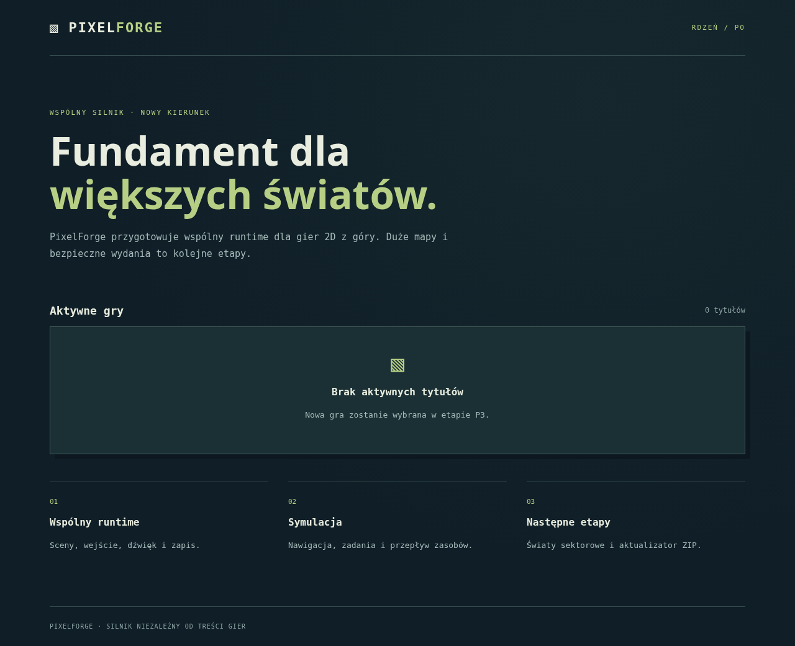

# P0 — wydzielony rdzeń PixelForge

2026-11-13 · plan 0.2 · `feature/p0-core-extraction` · baza `main` / `ead7666`.

## Rezultat

Zinwentaryzowano otwarte PR #1–#4 i przygotowano selektywny import **21 modułów**
rdzenia z przypiętego commita M3 `96b9e73`. Kod silnika jest identyczny z tym
snapshotem; nie scalono historycznego stosu PR. Utrzymano Phaser 4.2.1,
TypeScript strict, Vite i dotychczasowe wersje zależności z lockfile.

Zachowano host, sceny, walidację, wejście, audio, storage, postęp, model
symulacji, A*, kolejki, anulowanie, transport i produkcję. Publiczne API,
formaty oraz klucze lokalnych zapisów nie zostały zmienione. Brak nowych migracji.

Aktywny rejestr gier jest pusty. Nie przeniesiono gier, ich poziomów, grafiki,
muzyki, ZIP-ów ani testów zależnych od produktów. Ich historia i oryginalne
PR-y pozostały nienaruszone. Nie rozwijano ani nie wydawano porzuconych tytułów.

## Weryfikacja

| Kontrola                                          | Wynik                                                 |
| ------------------------------------------------- | ----------------------------------------------------- |
| `npm run lint`                                    | PASS                                                  |
| `npm run typecheck`                               | PASS                                                  |
| `npm test`                                        | 25 PASS                                               |
| `npm run build`                                   | PASS                                                  |
| `npm run test:e2e`                                | 11 PASS, 1 oczekiwany SKIP dotyku w projekcie desktop |
| Porównanie 21 plików silnika z M3                 | Identyczne bajtowo                                    |
| Statyczny build `/` i `/PixelForge/`              | PASS, desktop i emulacja Pixel 7, brak błędów JS/HTTP |
| Wykluczenie gier, fixture'ów i harnessu z `dist/` | PASS                                                  |

Testy jednostkowe sprawdzają kontrakty, reguły, łączenie źródeł inputu,
wersjonowanie i izolację zapisów, uszkodzony JSON, odmowę storage, A*, prześwit
pojazdu, nieosiągalny cel, anulowanie, różne delty i zachowanie wartości zasobów.
Zamiana receptury na inny stosunek jednostek nie wymaga zmiany modelu.

E2E używa prawdziwego EngineHost i syntetycznych fixture'ów: równoległe zadania,
pełny cykl transportu i przetwarzania, wynik i restart, przesuwanie/zoom kamery,
pauza, zapis/wznowienie, ochrona zapisu na ekranie tytułowym, izolacja adapterów,
błędna mapa, brak PNG i uszkodzony zapis. Adapter fizyki sprawdzono na geometrii
testowej: ruch, skok, pionowa i pozioma kolizja, interakcja, mute i zakończenie.
Dotyk sprawdza wybór jednostki, zlecenie i anulowanie.

Przejście przez przeszkodę w fixture wymaga rzeczywistego skoku; test nie
teleportuje jednostki i nie modyfikuje stanu silnika. Dane obserwowane w DOM są
telemetrią wyłącznie testowego harnessu, bez wysyłania danych na serwer.

Build pustej aplikacji P0 zawiera 3 pliki, łącznie **4286 bajtów** przed gzip.
Nie ładuje Phasera, gdy nie ma aktywnej gry; kod runtime jest kompilowany przez
TypeScript i uruchamiany w oddzielnym harnessie przeglądarkowym. Rozmiar ten
nie jest pomiarem przyszłego buildu gry ani wydajności dużego świata.

## Dokumentacja i granice etapu

- [CORE-INVENTORY.md](CORE-INVENTORY.md): źródła, zależności i decyzje integracyjne.
- [IMPLEMENTATION-PLAN.md](IMPLEMENTATION-PLAN.md): P1A–P1D oraz U0–U3 z kryteriami testów.
- `README.md`: aktualne uruchamianie rdzenia i testów, bez katalogu starych produktów.
- `docs/ROADMAP.md`: status P0 i następne działanie. Archiwum pozostaje niezmienione.

Testowano Chromium na Linuxie i emulację Pixel 7. Nie wykonano testów fizycznego
telefonu, Windows, Safari ani Firefox. Nie przeprowadzano testu grywalności,
ponieważ P0 nie dostarcza nowej gry.

Obecna symulacja nadal ma format małej siatki v1 (limit 128 × 128), pełne A*
i renderer bez sektorów. **P1 nie jest wykonane.** W P0 nie powstał generator
wydań z manifestem, walidator ZIP, staging, rollback ani panel. **P2/U0–U3 nie
są wykonane.** Hosting i adapter serwerowy pozostają do decyzji przy U1.

Nie wdrażano strony ani panelu na publicznym hostingu. P0 trafia do osobnego PR
do `main`; jego scalenie pozostaje decyzją właściciela. Następny zakres to P1,
a narzędzie U0 może być odrębnym PR. Wybór nowej gry P3 i Studio P4 pozostają
poza bieżącym zadaniem.
