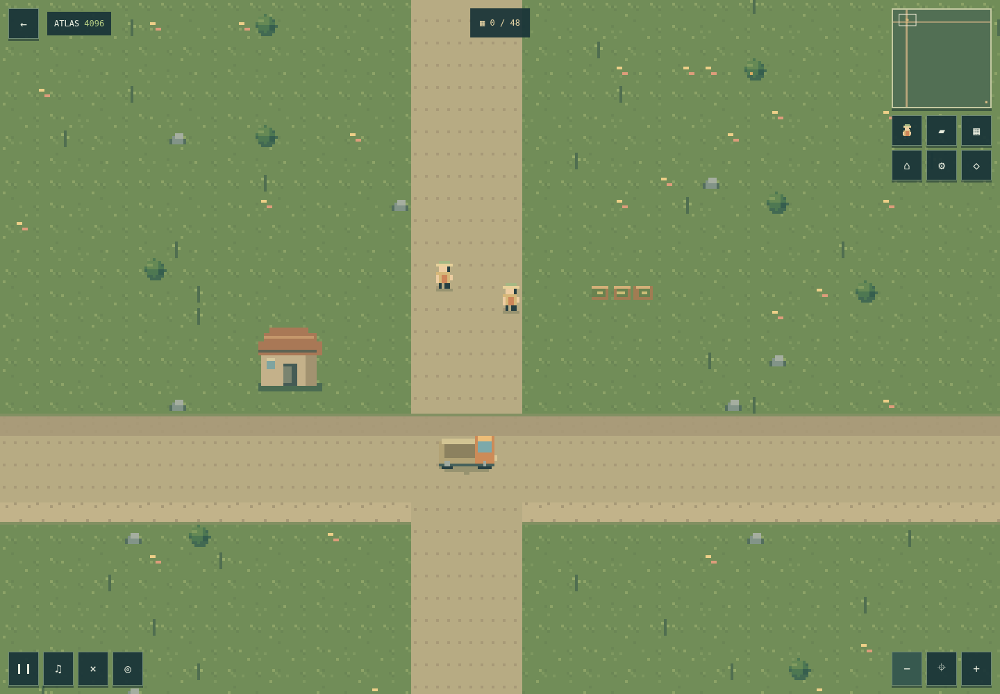

# P1 0.5.1 — Atlas w całym oknie

Zrealizowano uwagę użytkownika po akceptacji poprzedniego ZIP-a na hostingu.
Atlas wypełnia cały obszar strony, z minimapą i kontrolkami na świecie. Nie
wymaga F11 ani zgody przeglądarki na Fullscreen API. Powrót przywraca katalog.

## Zmiany

- Opcja `EngineHost.display: 'fill'` dla światów v2; adaptacyjny viewport,
  jednakowa całkowita skala obu osi i maksymalny rozmiar logiczny 640 × 960.
- Kamera zachowuje środek podczas resize, respektuje granice, a input, zoom
  i minimapa korzystają z bieżących wymiarów. `fit` i stary kontrakt v1 bez zmian.
- Cache Atlasu zwiększony z 24 do 48 sektorów danych; walidator sprawdza budżet
  dla maksymalnego widoku. Zmiana samego rozmiaru okna nie ładuje całej mapy.
- HUD uwzględnia safe-area, orientację i przyciski co najmniej 44 px.
  Początkowy kadr przesunięty tak, by kontrolki nie przykrywały źródła surowca.
- Nowy ZIP `downloads/pixelforge-p1-0.5.1-static.zip`, 272 pliki buildu,
  532 033 bajty, z kontrolą CRC i porównaniem każdego pliku z `dist/`.
  Poprzedni ZIP zachowano jako historyczne wydanie.

## Sprawdzenie

Lint, typecheck, build: PASS. Vitest **47 PASS**. Playwright **24 PASS + 2 SKIP**
(dotyk na desktopie). Regresja obejmuje zadania, produkcję, zapis, pauzę, fizykę,
błędy danych/assetów oraz nowe sprawdzenie pełnego okna, proporcji, trafiania,
narożników i powrotu do katalogu po resize. Rozmiary testowe: 1440 × 1000,
320 × 568, 844 × 390 i 412 × 839, w obu profilach przeglądarki.

Rozpakowany ZIP: **8/8 PASS** pod `/` i `/PixelForge/`, desktop/Pixel 7,
mapy 4096/8192; zero błędów JS/HTTP. Osobno obejrzano zrzuty obu profili.

[Telefon — pełne okno](screenshots/p1-full-window-mobile.png)

## Pomiar po zmianie

Chromium 158 headless, Linux/ANGLE SwiftShader, ta sama metoda `measure:world`:
20 sekund, 20 przeskoków kamery, zoom 0.5, aktywna trasa. Brak drugiego testu
przeglądarkowego w czasie pomiaru. Dane z rozpakowanego ZIP-a, nie serwera dev.

| Profil  | Mapa  |  FPS | P95 klatki | Heap po GC | Maks. tekstur sektorów |
| ------- | ----- | ---: | ---------: | ---------: | ---------------------: |
| desktop | 4096² | 55.7 |    33.3 ms |    8.8 MiB |                     20 |
| desktop | 8192² | 52.1 |    33.4 ms |   10.6 MiB |                     20 |
| mobile  | 4096² | 50.9 |    33.4 ms |    8.8 MiB |                     30 |
| mobile  | 8192² | 45.5 |    49.9 ms |   10.6 MiB |                     30 |

Cache osiągnął 48 sektorów danych. Maksymalna obserwowana powierzchnia tekstur:
20 MiB desktop, 30 MiB telefon. Pionowy ekran pokazuje więcej świata niż dawny
viewport 320 × 180, więc wynik nie jest bezpośrednio porównywalny z 0.5.0.
To pomiar emulacji na GPU/CPU środowiska, nie fizycznego telefonu; heap nie
obejmuje całego RSS/VRAM. Pełne dane: [JSON](P1-FULL-WINDOW-PERFORMANCE.json).
Nie testowano Safari/Firefox ani fizycznych urządzeń. Pozostaje ostrzeżenie
Vite o rozmiarze modułu Phasera; bez nowych zależności runtime.

Zmiany trafiają do istniejącego PR #6, bez merge i wdrożenia. Następny osobny
zakres: U0 — format paczek i walidator offline. Nowe gry nie zostały rozpoczęte.
