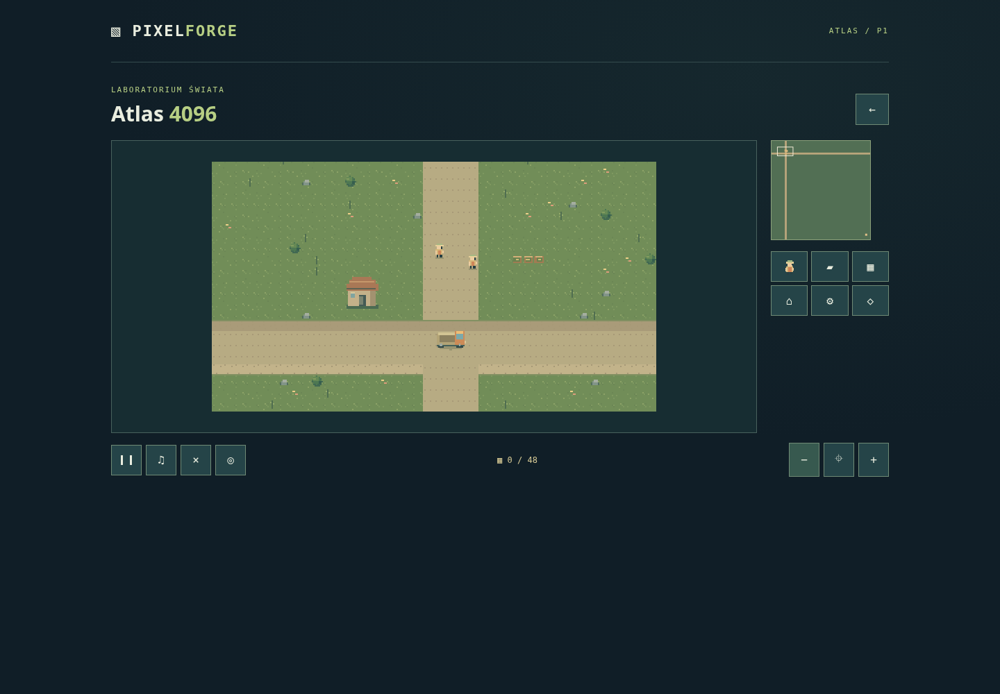

# Raport P1 — duże światy

Data: 2026-11-13. Gałąź: `feature/p1-large-worlds`. Baza: P0 `de1945d`
([PR #5](https://github.com/ankelmarek/PixelForge/pull/5)). P1 stanowi oddzielny
commit i PR do `main`; żaden PR nie został automatycznie scalony ani wdrożony.
Wersja projektu: 0.5.0, Phaser nadal 4.2.1; bez nowych zależności.

## Rezultat

- Uruchamialne laboratorium **Atlas** w wariantach **4096 × 4096** i
  **8192 × 8192**. Osobny klient `src/demos/large-world`, pusty katalog produktów,
  bez kodu/zasobów zakończonych tytułów. Start, wznowienie, pauza, wyciszenie,
  restart i powrót. Brak pisanych instrukcji gameplayu.
- Poziom v2 i walidowany katalog sektorów. Kafle RLE, warstwy, rewizja i stabilne
  identyfikatory. 64/256 sektorów po 512 px; jeden atlas 256 × 16 px, oryginalne
  sprite'y CC0. Generator jest deterministyczny — 268 plików identycznych po
  ponownym uruchomieniu. Nie ma pojedynczego PNG świata.
- Limitowany cache danych LRU, anulowanie żądań, maksymalnie cztery równoległe
  pobrania i dwie nowe tekstury na klatkę. Widok z marginesem; culling i usuwanie
  tekstur, sprite'ów, cieni i ładunków. Stan obiektów nie należy do cache.
- Przeciąganie myszą/palcem, kółko z kotwicą, zoom, minimapa i przejście do
  obiektu. Narożniki osiągalne; kamera uwzględnia wymiary świata i zoom.
  Nearest-neighbor oraz skalowanie CSS zachowują ostre piksele.
- Graf spójnych komponentów i przejść regionów, lokalne A* z budżetem, indeks
  kolizji i prześwit pojazdu 3 × 3. Zlecenie nie uruchamia pełnego A* całej mapy.
  Portal wybierany blisko trasy, zamiast wymuszać objazd narożnikiem sektora.
- Model logiczny 20 Hz i interpolacja widocznych jednostek. Zadania, zasoby,
  transport i produkcja działają poza ekranem. Wersjonowany zapis v2 obejmuje
  kolejki, trasy, fazy pracy, zasoby, kamerę i zgodność rewizji świata.
- Regresja starego adaptera v1 pozostaje testowana; dotychczasowe klucze zapisów
  bez zmian. Poprawiono także odziedziczoną sygnaturę zdarzenia kółka Phasera.

## Zmienione obszary

| Obszar        | Pliki / odpowiedzialność                                                                               |
| ------------- | ------------------------------------------------------------------------------------------------------ |
| Światy        | `src/engine/world/{validation,sectors,renderer,navigation}.ts`                                         |
| Runtime       | `simulation/{types,validation,navigation,model,pointer,runtime,save}.ts`, `core/EngineHost.ts`, `api/` |
| Klient        | `src/demos/large-world/index.ts`, `src/app/world-lab.ts`, launcher i CSS                               |
| Dane i oprawa | `public/assets/demos/large-world/`, `tools/generate-world-demo.py`                                     |
| Kontrole      | `tests/unit/world.test.ts`, `tests/e2e/world.spec.ts`, `tools/measure-world.mjs`                       |
| Dokumentacja  | README, roadmapa, plan implementacji, kontrakt dużych światów, ten raport                              |

## Weryfikacja

- `npm run lint`, `npm run typecheck`, `npm run test`, `npm run build`: PASS.
- Vitest: **45 PASS**, w tym 20 testów nowych światów.
- Playwright: **22 PASS, 2 SKIP** (wyłącznie przypadki dotyku na desktopie).
  Po uzupełnieniu kontroli liczby klatek atlasu powtórzono oba scenariusze
  diagnostyczne: **2 PASS**.
- Generator: **268/268 plików identycznych** przy ponownym wygenerowaniu.
- Build pod `/` i `/PixelForge/`, desktop i Pixel 7, oba rozmiary: **8/8 PASS**,
  zero błędów JS i HTTP zasobów, bez przewijania poziomego. Na starcie 9 sektorów.
  `dist/`: 272 pliki, około 2,90 MB nieskompresowanych danych.
- Obraz sprawdzono na screenshotach desktop/mobile: ostre kafle, ciągłe drogi
  na granicach sektorów, ikonowe kontrolki i dopasowanie do ekranu.

[Widok w emulacji telefonu](screenshots/p1-mobile.png).

Testy obejmują 4096 i 8192, większy konfigurowany wymiar 16384, zły manifest,
niepełny/obcy sektor, RLE i ciągłość drogi przy granicach, limity cache, anulowane
odpowiedzi, nieosiągalność i objazd odległego przejścia, prześwit pojazdu oraz
budżety nawigacji. Cały cykl zasobów dochodzi do celu bez renderera, a podział
delta nie zmienia wyniku. Zapis odtwarza trasę między sektorami i odrzuca
uszkodzenia/inną rewizję.

Przeglądarka sprawdza narożniki, culling, kółko, przeciąganie, fizyczne zdarzenia
dotyku w emulacji, pracę poza kamerą, odświeżenie/wznowienie, restart, brak
atlasu, wadliwy sektor, uszkodzony zapis, zachowanie zapisu na ekranie tytułowym
i wyjście przy oczekujących pobraniach. Dawny harness rdzenia sprawdza również
fizykę, reguły, kolejki, transport, cel i izolację.

## Pomiary

Produkcja Vite, Chromium 158.0.8127.18 headless, Linux x86_64, środowisko
z 5 vCPU Intel Xeon Platinum 8573C, renderer ANGLE/Vulkan **SwiftShader**. Desktop 1440 × 1000; emulacja Pixel 7
412 × 839. Bez ograniczania CPU ani sieci. Każda próba: 20 sekund, zoom 0.5,
20 skoków kamery i aktywne zlecenie. FPS obliczono z odstępów rAF, pamięć JS
przez CDP. W czasie pomiaru nie uruchamiano drugiej przeglądarki testowej.

| Profil           | Świat | Średnie FPS | Mediana / P95 klatki | JS heap po GC | Klatki > 50 ms |
| ---------------- | ----- | ----------: | -------------------: | ------------: | -------------: |
| Desktop          | 4096² |        56.6 |       16.7 / 16.8 ms |       8.1 MiB |              8 |
| Desktop          | 8192² |        55.2 |       16.7 / 33.3 ms |       9.9 MiB |             11 |
| Emulacja Pixel 7 | 4096² |        58.2 |       16.7 / 16.8 ms |       8.0 MiB |              0 |
| Emulacja Pixel 7 | 8192² |        57.1 |       16.7 / 16.8 ms |       9.8 MiB |              1 |

W każdej próbie: **24 sektory danych maksymalnie w cache, 20 tekstur sektorów
w zaobserwowanym widoku**, zero błędów JS. Maksymalna zaobserwowana powierzchnia
RGBA tych tekstur wynosi **20 MiB**. To estymacja jednej powierzchni, nie cały
VRAM/RSS procesu — przeglądarka przechowuje także kopie canvas/GPU. Pamięć JS
po GC nie obejmuje zasobów GPU ani wszystkich buforów natywnych; pełne pola CDP
są w [surowym wyniku](P1-PERFORMANCE.json).

Powiększenie powierzchni świata 4× nie zwiększa limitu grafiki. Wyniki około
55–58 FPS dotyczą intensywnego ładowania przy skokach kamery; nie deklarujemy
stałych 60 FPS. Desktop 8192 miał P95 około 33 ms i pojedyncze dłuższe klatki.
To punkt odniesienia dla dalszej optymalizacji, a nie wynik fizycznego telefonu.

## Ograniczenia i następny krok

- P1 jest demonstracją techniczną i fundamentem kolejnych gier, nie nową
  produkcją na 20–35 minut. Katalog gier pozostaje pusty. P3 wymaga wyboru tytułu.
- Test mobilny to emulacja Pixel 7 na CPU/GPU środowiska Linux. Nie testowano
  fizycznego telefonu, iOS/Safari ani Firefox. Wyniki nie są obietnicą 60 FPS
  na każdym sprzęcie. Testy nie zastępują playtestu czytelności z nową osobą.
- Przy dalekim skoku kamery widać kolor terenu do czasu wczytania nowych sektorów.
  P1 nie obejmuje PWA/offline ani pakowania świata do pojedynczego żądania.
- Topologia nawigacji jest statyczna. Indeks powstaje raz na klasę ruchu przy
  pierwszej trasie. Graf ogranicza pracę polecenia; wynik nie musi być globalnie
  najkrótszą trasą. Dynamiczne drogi i tysiące aktorów są poza tym etapem.
- Domyślne budżety są konfigurowalne; zmierzono dwie konkretne mapy i trzy
  jednostki. Nie deklarujemy zmierzonej wydajności dla maksymalnych limitów.
- Build ostrzega o dużym module zawierającym Phaser (~1,46 MB, ~396 kB gzip).
  Moduł ładuje się dopiero po otwarciu laboratorium. Ostrzeżenie nie zostało
  ukryte ani rozwiązane przez dodanie bibliotek.
- Następny etap: **P2/U0**, generator paczek full ZIP i walidator offline.
  Aktualizator/panel nie są zaimplementowane, nie wybrano hostingu, nie wykonano
  publicznego wdrożenia. U1–U2 wymagają osobnego zakresu zgodnego ze specyfikacją.

Kontrakt i powtarzalny sposób pomiaru: [LARGE-WORLDS.md](LARGE-WORLDS.md).

## Paczka do ręcznego wgrania na hosting

Na prośbę użytkownika dodano `downloads/pixelforge-p1-0.5.0-static.zip`,
sumę SHA-256 i instrukcję hostingu. Archiwum zawiera wyłącznie 272 pliki
produkcyjnego `dist/` z kodu `9261443`, bez nadrzędnego folderu. Kontrola CRC
oraz porównanie SHA-256 każdego wpisu z buildem potwierdzają identyczność.
Rozpakowany ZIP sprawdzono osobno pod `/` i `/PixelForge/`, na desktopie
oraz w emulacji Pixel 7. Kod runtime nie został zmieniony. To dystrybucja
ręczna P1; nie wdrożono generatora/walidatora aktualizatora P2/U0.
