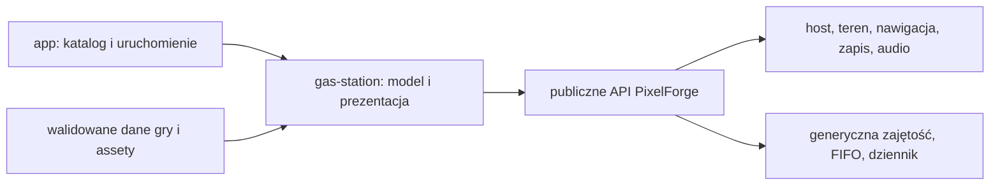

# Stacja na Trasie — projekt wdrożenia S0

**Data:** 14 listopada 2026. **Status S0:** zaakceptowany następnym poleceniem
„Możesz kontynuować”. Implementację S1 opisują sekcja 14 i [raport S1](S1-REPORT.md).
Wymagania: [specyfikacja](STACJA-BENZYNOWA.md), [roadmapa](ROADMAP.md),
[AGENTS](../AGENTS.md). Wyniki wykonanych kontroli: [raport S0](S0-REPORT.md).
Poniższe kontrakty i liczby są decyzjami dla kolejnych etapów, nie deklaracją
istnienia wszystkich funkcji S2–S4. S1 zostało osobno zlecone; kolejne etapy
wciąż wymagają następnego polecenia.

## 1. Baza i podział odpowiedzialności

Gałąź `feature/p3-stacja-benzynowa` powstała z `7f678a1` —
[PR #16](https://github.com/ankelmarek/PixelForge/pull/16), Winobranie W3,
PixelForge 0.11.0. Sprawdzono również PR #15 i stan `main` (`45dcfa2`).
`main` zawiera dokumentację, a nie kompletny runtime. Nie scalono PR #16;
nowa gałąź zachowuje jego kod i najnowszą specyfikację najmu Skoczki.

| Dostępne w bazie                                     | Rzeczywisty kontrakt i decyzja dla Stacji                                                                                                                                                                                   |
| ---------------------------------------------------- | --------------------------------------------------------------------------------------------------------------------------------------------------------------------------------------------------------------------------- |
| `src/engine/api/client.ts`                           | `ClientDefinition`, `ClientRuntime`, komendy, snapshot, własne kontrolki. Nowy klient `gas-station`, bez warunków po ID w silniku.                                                                                          |
| `src/engine/api/index.ts`, `world/renderer.ts`       | Host, sceny przepływu, `SectorRenderer`, kamera i `pixelAlignedScroll`. Używać pełnego okna oraz istniejącej poprawki zoomu 0.5.                                                                                            |
| `src/engine/api/terrain.ts`, `world/mutable-grid.ts` | Headless `MutableGrid`. To dane podłoża, nie gotowa usługa własności, budowy ani kolejek.                                                                                                                                   |
| `src/engine/api/strategy.ts`, `world/navigation.ts`  | `RegionalNavigator.prepare/fork/invalidate/findPath`, lokalne sektory i rewizje. Profile przechodniości określa klient. Brak kierunkowych pasów, zajętości przez pojazdy i rezerwacji skrętów.                              |
| `strategy/services.ts`                               | `ScenarioClock` z krokiem 50 ms, pauzą i ×1/×2/×4; `Ledger` z całkowitymi kwotami, ID i zaległościami; `Inventory`, `Reservations`, `ownsAll`, funkcje siatki. Brak FIFO, wyceny zapasów i dziennika kategorii finansowych. |
| `strategy/climate.ts`                                | `randomSample(seed, stream, index)` i czasowe `ClimateEventService`. Wybór zdarzeń, limit krytycznych alarmów i napływ klientów będą logiką Stacji.                                                                         |
| `strategy/lots.ts`                                   | Identyfikowane partie i zachowanie ilości/jakości. Nie przenosić winiarskich odmian ani roczników do paliwa. W S1 wystarczy ewidencja ilości i kosztu zapasu.                                                               |
| `systems/versioned-save.ts`                          | `VersionedSave<T>`, walidacja przed odczytem/zapisem, rozróżnienie absent/invalid/ready; limit 4 mln znaków. Migrację i zgodność wersji definiuje klient.                                                                   |
| `systems/audio.ts` przez `ClientContext.audio`       | Odblokowanie, wyciszenie, pauza, proste tony i muzyka. Brak próbek, przestrzennych pętli, magistral i limitu głosów; wymagają rozszerzenia.                                                                                 |
| `src/games/winobranie-rts/`                          | Dowód działania budowy, gospodarki i zapisu na dużym świecie. Model pracowników, parcel i kampanii jest specyficzny dla winnicy; nie importować go do Stacji.                                                               |
| `tools/release.py`, `admin-updater/`, testy paczek   | Gotowa dystrybucja full ZIP, instalacja, rollback i public_html. Stacja nie potrzebuje nowego instalatora ani backendu.                                                                                                     |

Historyczny [kontrakt P1](LARGE-WORLDS.md) opisuje jeszcze statyczną topologię.
Aktualny kod ma już `fork` i lokalne `invalidate` oraz przygotowanie indeksu
partiami. Nie oznacza to gotowej symulacji ruchu ulicznego.



Plan plików klienta: `index.ts`, `schema.ts`, `model.ts`, `scenarios.ts`,
`traffic.ts`, `customers.ts`, `fuel.ts`, `shop.ts`, `economy.ts`, `placement.ts`,
`runtime.ts`, `view.ts`, `controls.ts`, `sounds.ts`; dopiero S2 `tenant-lease.ts`,
dopiero S3 `car-wash.ts`. Dane: `public/assets/games/gas-station/`.
Headless model nie importuje Phasera ani DOM. Renderer nie księguje sprzedaży.
JSON zawiera wyłącznie dane i akcje z zamkniętego katalogu.

Komendy modelu przychodzą przez istniejące `client-action` po walidacji
payloadu. Minimalny zamknięty kontrakt S1 (projekt typów, bez wykonywania
tych deklaracji z JSON):

```ts
type FuelKind = 'e95' | 'on';
type StationAction =
  | { type: 'order-fuel'; fuel: FuelKind; volumeDl: number; quoteId: string }
  | { type: 'order-goods'; items: { productId: string; count: number }[] }
  | { type: 'cancel-delivery'; orderId: string }
  | { type: 'set-pump-open'; pumpId: string; open: boolean }
  | { type: 'assign-worker'; workerId: string; role: 'forecourt' | 'checkout' }
  | { type: 'build-pump'; previewId: string; topologyRevision: number };

type ActionResult =
  | { ok: true; commandId: string }
  | {
      ok: false;
      reason:
        | 'invalid'
        | 'stale'
        | 'no-funds'
        | 'no-capacity'
        | 'occupied'
        | 'unreachable'
        | 'finished';
    };
```

Koperta komendy: ID sesji, rosnący numer polecenia i powyższa akcja.
Podwójny klik z tym samym ID nie powiela zakupu; nowe ID nadal przechodzi
kontrolę aktualnej pojemności i salda. `quoteId` odwołuje się do ceny
hurtowej zapisanej w modelu, nie do kwoty zaufanej z UI. Zmiana cen
detalicznych, nowe role i umowy rozszerzą katalog dopiero w S2.
Kamera, selekcja, zoom, pauza i prędkość pozostają osobnymi komendami
runtime; wybór obiektu nie zmienia gospodarki.

## 2. Zakres usług generycznych

Nowe publiczne eksporty dodawać dopiero wraz z użyciem i testami S1.
Poniższe nazwy są proponowane; nie istnieją jeszcze w API.

| Usługa                      | Minimalny kontrakt                                                                                                                                                     | Poza zakresem usługi                                         |
| --------------------------- | ---------------------------------------------------------------------------------------------------------------------------------------------------------------------- | ------------------------------------------------------------ |
| `OccupancyReservations`     | `tryClaim(owner, cells)`, `tryMove(owner, sweptCells, destinationCells)`, `release(owner)`, odtworzenie i walidacja rozłącznych footprintów. Operacja cała albo żadna. | Marka auta, paliwo, ceny, cierpliwość.                       |
| `SlotQueue`                 | Stabilne ID stanowisk, `join(id, arrivalTick, serial)`, `head`, `leave`, trwała kolejność i fizyczne sloty przekazane przez klienta.                                   | Decyzja, czy klient kupuje kawę; samodzielny ruch sprite'a.  |
| `TransactionJournal`        | Rozszerzenie/adapter `Ledger`: ID, kwota gotówkowa, kategoria, koszt rozchodu, referencja. Zastosowanie wpisu dokładnie raz i walidacja sum.                           | Nazwy kategorii sklepu, podatki, arbitralny skrypt księgowy. |
| Audio — zgodne rozszerzenie | Rejestrowane cue/pętle, gain kanałów, ograniczenie głosów, wyciszenie i pauza; zachowane dotychczasowe `play/music`.                                                   | Markowe motywy i wybór dźwięku konkretnej usługi.            |

Nie budować na zapas całego `TrafficAndQueueService`, ECS ani uniwersalnego
edytora. Kierunkowy graf pasów i zachowania kierowców pozostają kompozycją
klienta nad nawigacją i generyczną zajętością. Budowa używa `ownsAll`,
`RegionalNavigator.fork` i `invalidate`; wspólny mechanizm preview/commit
wydzielić tylko wtedy, gdy nie wymaga pojęć ze Stacji. Nie przepisywać
Winobrania na nowe usługi jako warunku uruchomienia S1.

## 3. Świat, dane i budowa

Pierwsza mapa: **4096 × 4096 px**, siatka 256 × 256, kafel 16 px,
sektor 32 × 32 kafle = 512 px, **64 sektory**, cache 48. Wariant 8192 ma
256 sektorów, ten sam format, lecz należy do późniejszych pomiarów.
Viewport jest niezależny: `display: 'fill'`, logiczny limit hosta 640 × 960,
zoom 0.5–2, nearest-neighbor, bez jednej tekstury całego świata.

Startowa parcela: 50 × 44 komórki = **800 × 704 px**; docelowy spójny obszar
około 106 × 75 = 1696 × 1200 px. Droga publiczna z rozdzielonym wjazdem
i wyjazdem jest trwałą, niedającą się zabudować metadaną. Układ początkowy:
jednokierunkowa pętla, dwa stanowiska na jednej wyspie, sklep z kasą,
4 miejsca parkingowe, dojście piesze i osobna zatoka rozładunku cysterny.
Zakup parcel, swobodne drogi i wiele obiektów dopiero S2; S1 ma jeden
rzeczywiście działający podgląd dodatkowego stanowiska w gotowej zatoce.

`StationDefinition` v1 zawiera: `gameId`, `gameVersion`, `rulesRevision`,
`scenarioId`, `world` zgodny z `TerrainWorld`, katalog parcel, obiektów,
portów obsługi, pasów i przejść pieszych, konfigurację ekonomii, populacji,
kampanii i limity. Sektory przechodzą istniejący `validateSector`.

Walidator przed startem sprawdza: unikalne ID i referencje; dozwolone lokalne
URL-e; pełne pokrycie sektorów; całkowite kwoty/ilości w limitach; wejścia
w granicach; zgodność footprintu z orientacją; dojazd **i wyjazd** każdej usługi;
niezależną ścieżkę pieszą do kasy; brak przecinania publicznej drogi budynkiem;
odpowiedni cache dla maksymalnego viewportu i minimalnego zoomu.

Budowa: `preview(command, topologyRevision)` → koszt, footprint, porty,
zmienione sektory, wynik dostępności albo kod odmowy. Podgląd używa kopii
topologii; nie pobiera pieniędzy. `commit` ponownie sprawdza saldo, rewizję,
własność i zajętość, następnie publikuje jednocześnie koszt i zmianę mapy.
Zmiana musi zachować drogę do wyjścia dla wszystkich obecnych pojazdów,
klientów pieszych, pracowników i zamówionych dostaw.

Nie wolno zabudować aktualnego ani zarezerwowanego obszaru skrętu. S1/S2
odrzucają taką operację bez opłaty; kolejka odroczonych budów nie jest potrzebna.
`invalidate(bounds, halo)` obejmuje maksymalny obrys skrętu danej klasy,
rewizje dotkniętych tras są przeliczane przed kolejnym wjazdem w segment.
Pozycje pozostają fizyczne; nie odbudowujemy całego świata przy każdym ruchu.

## 4. Czas, losowanie i limity

Stały krok **50 ms**, 20 ticków/s. Stan zależy od ticka i seeda, nie od FPS,
zegara systemowego ani widoczności sektora. `ScenarioClock` sam nie ogranicza
dużej delty: adapter runtime przyjmuje najwyżej 100 ms na klatkę przed
mnożnikiem, czyli maksymalnie 8 kroków przy ×4. Ukrycie/rozmycie karty
pauzuje; wznowienie odrzuca czas nieobecności. Przy przeciążeniu symulacja
zwalnia, nie przeskakuje obsługi. Model headless może wykonać dokładnie N ticków.

Kolejność kroku: (1) zwalidowane komendy według numeru sekwencji, (2) granice
zmian i aktywne zdarzenia, (3) kandydaci z drogi i przyjęcia, (4) przydziały
stanowisk i rezerwacje, (5) ruch, (6) praca, transfery i transakcje, (7) wyjazdy,
metryki i finał. Granica zmiany rozlicza przedział `[start, end)`; transakcja
nowego ticka należy już do nowej zmiany. Snapshot tylko po pełnym kroku.

Osobne numery strumieni RNG: ruch, potrzeby, cierpliwość, zdarzenia i kosmetyka.
Indeksem ruchu jest numer kandydata, zdarzeń — numer okna. Kamera, render
i podgląd prognozy nie zużywają losowań modelu. Save przechowuje seed,
liczniki i podjęte decyzje; wznowienie nie losuje lepszego klienta.

| Budżet MVP                         | Limit i zachowanie przy wyczerpaniu                                                                                                            |
| ---------------------------------- | ---------------------------------------------------------------------------------------------------------------------------------------------- |
| Aktywne jednostki logiczne łącznie | **32**, także poza kamerą; ostrożny budżet wyjściowy P1, nie dowód wydajności nowego klienta.                                                  |
| Pojazdy klientów na stacji         | 10; limit obejmuje kolejkę, parking i tankowanie, niezależnie od renderingu.                                                                   |
| Kierowcy piesi                     | Do 10, po jednym na przyjęty pojazd. Budżet pieszego rezerwowany już przy przyjęciu auta.                                                      |
| Personel obu operatorów razem      | Do 6; początkowo 2 własnych. Najemca zużywa ten sam globalny budżet.                                                                           |
| Dostawy / ruch przejazdowy         | Do 2 pojazdów dostaw i do 4 przejazdowych; razem z powyższymi najwyżej 32.                                                                     |
| Budynki i obiekty interaktywne     | Do 128, statyczne prostokąty dróg/przeszkód do 256; poniżej pułapów P1.                                                                        |
| Kolejki S1                         | Przy paliwie 3 oczekujące auta + 2 obsługiwane; przy kasie 5 slotów łącznie; parking 4. Wolny budżet globalny nie powiększa fizycznej kolejki. |
| Nowe trasy                         | Najwyżej 2 zapytania regionalne/tick; nadmiar czeka z zachowaniem FIFO. Przygotowanie indeksów partiami podczas ładowania.                     |

Kandydat generowany poza stacją nie musi zostać aktywną jednostką. Brak miejsca
oznacza przejazd bez zjazdu; pełny budżet nie tworzy niewidzialnej kolejki bez
końca. Autokar w S3 to jeden pojazd i jeden reprezentant zakupów grupowych,
nie kilkadziesiąt nowych pieszych. Przyjętych klientów nigdy nie usuwamy
z powodu wyjścia kamery. Pojazdy powstają/znikają tylko w portalach drogi
przy granicy świata, pod osłoną scenografii, nie na środku widoku.

## 5. Ruch, kolejki i obsługa

### Geometria i brak zakleszczeń

Samochód: footprint 2 × 3 komórki, łuk w obszarze 4 × 4; dostawczy 2 × 4,
łuk 5 × 5; ciężki/cysterna 3 × 6, łuk 8 × 8. To parametry stylizacji gry,
nie model prawdziwych wymiarów. S1 potrzebuje osobowego i cysterny.
Graf segmentów określa dozwolone kierunki i połączenia. `RegionalNavigator`
wyznacza korytarz terenu; sam nie rozstrzyga kierunku ani pierwszeństwa.
Przejścia między sektorami muszą zgadzać się z kierunkowym grafem pasów.
Lokalny plan manewru uwzględnia orientację i cały obrys, a nie sam środek auta.
Brak legalnego planu daje `unreachable`, bez awaryjnego A* całej mapy.

Prędkości startowe: auto 4 komórki/s, cysterna 2.5, pieszy 2; skręt połowa
prędkości jazdy. Postęp segmentu zapisujemy w 1/256 komórki z resztą
dzielenia przez 20 ticków/s. Ostatni krok zatrzymuje się na końcu segmentu,
nie przeskakuje do środka następnego. Obraz interpoluje pozycję; sprawdzanie
zajętości używa logicznego obrysu i całego odcinka ruchu w danym kroku.
Port wysiadania leży poza footprintem zaparkowanego auta i też wymaga
wolnego miejsca przed utworzeniem pieszego.

Ruch rezerwuje atomowo zamiatany obszar oraz wolne miejsce za skrzyżowaniem.
Przednia rezerwacja nie zwalnia zajętości tyłu auta przed jego przejazdem.
Konflikty rozstrzyga czas zgłoszenia i stabilny serial; dostawa nie wypycha
już obsługiwanego klienta. Przejście piesze działa jako wspólny zasób;
samochód czeka, jeżeli korzysta z niego pieszy. S1 nie ma wyprzedzania ani
cofania między autami. Zamknięcie pompy nie zamyka pasa wyjazdowego.

Nie wjeżdżamy w skrzyżowanie bez wolnego następnego slotu. Kolejki mają zatoki
poza drogą przelotową, cysterna osobny dojazd. Początkowa pętla ma rezerwę
wolnego segmentu, a walidacja budowy zachowuje tę rezerwę. Wspólne wąskie
odcinki przyznają przejazd całemu jednemu manewrowi. Plan drogi bez osiągalnej
zatoki oczekiwania/wyjazdu jest niedopuszczalny w S2.
Wykrycie cyklu oczekiwania zatrzymuje nowe wjazdy i przelicza trasy do
legalnych zatok; nie teleportuje auta ani nie wygasza zajętej rezerwacji.
Timeout jest diagnostyką i testem błędu, nie metodą usuwania blokującego klienta.

### Maszyny stanów

| Encja          | Stany i istotne przejścia                                                                                                                                                     |
| -------------- | ----------------------------------------------------------------------------------------------------------------------------------------------------------------------------- |
| Pojazd klienta | `approaching → deciding → entering → queued → drivingToService → servicing → drivingToExit → leaving → finished`; alternatywnie `bypassing`, `waitingForRoute`, `abandoning`. |
| Kierowca       | `inVehicle → walkingToShop → queuedAtCheckout → paying → walkingBack → inVehicle`; zaistnienie pieszego wymaga legalnego postoju auta.                                        |
| Stanowisko     | `open / draining / closed / broken / upgrading`; zamknięcie zatrzymuje nowe przydziały, nie kasuje obsługi już wykonanej.                                                     |
| Pracownik      | `idle → walking → serving/unloading/restocking → idle`; rola, właściciel i cel zapisane. Brak obsady zatrzymuje postęp usługi.                                                |
| Dostawa        | `ordered → travelling → waitingAtBay → unloading → departing → completed`; anulowanie przed rozładunkiem lub rozliczenie pozostałego ładunku po częściowym rozładunku.        |

`Customer` ma stabilne ID, pojazd, typ, budżet, rodzaj/ilość paliwa, potrzeby
sklepowe i myjni, cierpliwość, zaakceptowaną ofertę oraz wyniki. Plan potrzeb
to opcjonalne etapy; klient tylko po kawę jedzie na parking. Nie kierujemy
wszystkich przez pompę, sklep i myjnię.

FIFO jest kolejnością zapisanych zgłoszeń, nie kolejnością sprite'ów w tablicy.
Wybór jednej z dostępnych pomp uwzględnia paliwo i osiągalność. Przed rozpoczęciem
tankowania przyznajemy pompę oraz bilet do kasy. Pozwala to ograniczyć liczbę
aut czekających na płatność. Kierowca płaci w kasie, auto pozostaje przy pompie;
zakupy spożywcze w tym samym koszyku są opcjonalne. Po płatności wraca i odjeżdża.
Osobne parkowanie przed zakupami dotyczy klientów sklepowych oraz dodatkowego
pobytu po zakończeniu tankowania. Kasjer obsługuje obie grupy według FIFO.

Tankowanie jest samoobsługowe po krótkim przygotowaniu przez pracownika
stacji; pracownik może przygotować drugie auto podczas pracy pierwszej pompy.
Zmiana ceny dotyczy nowych ofert, nie rozpoczętego paragonu. Brak paliwa
zamyka przyjęcia danego typu. Rezygnacja z kolejki zwalnia bilet i prowadzi
pojazd fizycznie do wyjazdu. Po wykonaniu części usługi klient najpierw płaci
za rzeczywistą ilość; timeout nie kasuje należności. Przerwanie pracy kasjera
odkłada płatność, nie pozwala odjechać za darmo.

## 6. Paliwa, zapasy i spójna ekonomia

Jednostki: **1 moneta = 100 jednostek księgowych**, paliwo w **decilitrach**
(10 dL = 1 L), towary w sztukach, czas w tickach. Kwoty i ilości muszą być
`Number.isSafeInteger`, dodatnie lub zerowe zgodnie z polem. Ceny za litr
przeliczamy na pełne decilitry; paragon zaokrągla tylko raz przy zamknięciu:
`floor((volumeDl * pricePerL + 5) / 10)`. Cena i koszt partii pozostają zapisane.
Nie sumujemy zaokrąglonych przychodów z każdego ticka tankowania.

Zapas paliwa ma ilość i całkowity koszt nabycia. Rozchód proporcjonalnie
przenosi koszt zapasu na konkretny paragon; reszta zaokrąglenia pozostaje
w magazynie, ostatni rozchód zabiera cały pozostały koszt. Ten sam schemat
dotyczy napojów/przekąsek/kawy. Dzięki temu suma kosztu rozchodu i zapasu
zawsze równa się kosztowi przyjętych dostaw, także przy mieszaniu partii.

Dostępne paliwo = stan fizyczny minus ilości zarezerwowane do tankowania.
Wolna pojemność = pojemność minus stan fizyczny minus **pozostały do przyjęcia**
ładunek zamówionych dostaw. Nie liczymy przyszłej, hipotetycznej sprzedaży.
Transfer w kroku zmniejsza jednocześnie ładunek cysterny i jej rezerwację
pojemności, zwiększając stan zbiornika. Pompa analogicznie zmniejsza stan
i rezerwację klienta, a zwiększa wydane litry paragonu. Brak ujemnych ilości,
przepełnienia i rezerwacji większych niż dostępny zasób.

Zamówienie pobiera koszt towaru i transportu raz; do przyjęcia towar jest
aktywem `inTransit`, potem przechodzi do magazynu. Anulowanie zwraca koszt
niedostarczonej ilości według ceny zamówienia; transport po wysłaniu pozostaje
kosztem. Każdy etap ma ID z `orderId`; save w trakcie rozładunku nie ponawia
zakupu. Dostawa bez dojazdu oczekuje w legalnej zatoce, a nie zasila zbiornika
na odległość. Planowana budowa musi uwzględniać zamówioną cysternę.

### Trzy odrębne wielkości w panelu

- **Gotówka:** początkowe środki + otrzymane płatności − faktyczne wydatki.
- **Wynik operacyjny:** sprzedaż własna pomniejszona o koszt sprzedanego
  paliwa/towaru, powiększona o czynsz/udział, pomniejszona o płace, transport,
  utrzymanie, naprawy, wodę i energię. Zakup zapasu nie jest jednocześnie
  ponownym kosztem jego rozchodu.
- **Wartość netto:** gotówka + zapas i towar w drodze + należności za wykonane
  usługi + wartość odsprzedaży infrastruktury − zaległości − kapitał pożyczki.
  Zakup trwałego obiektu nie obniża automatycznie całego wyniku operacyjnego.

Jedno źródło prawdy: wpis `JournalEntry { id, tick, category, cashDelta,
inventoryCostDelta, receivableDelta, operatingDelta, refId }`, zamknięty
katalog dozwolonych typów transakcji w kliencie. Płatność gotówkowa zmienia
saldo, a `operatingDelta` określa wynik; to dwa widoki tej samej transakcji.
`Ledger.income - costs` sam nie wystarcza do liczenia zysku.

W sklepie własnym kategoria `owned_shop_margin` przechowuje przy płatności
pełne `cashDelta` sprzedaży i **marżę** jako `operatingDelta`; zakup to
`shop_stock_cost` z wydatkiem i zwiększeniem zapasu, bez ponownego kosztu
operacyjnego. `shop_staff_cost` to płace. U najemcy obrót trafia wyłącznie do
jego księgi; księga stacji dostaje tylko `tenant_rent`, `tenant_share` oraz
własne `tenant_building_cost`. Nie dopisujemy marży własnego sklepu przy najmie.

Wydanie paliwa tworzy należność i rozchód; późniejsza płatność tylko rozlicza
tę należność. Koszyk sklepu jest sprawdzany i przekazywany przy kasie razem
z zapłatą. Jedna komenda modelu zatwierdza komplet zmian albo żadną.
ID paragonu, zamówienia, płacy i rozliczenia najmu jest trwałe; odrzucona
operacja nie zużywa ID, powtórzenie zatwierdzonej nie ma skutku.

Nie tworzymy wpisu dziennika na każdy tick lub decilitr. Otwarty paragon
przechowuje narastające litry, koszt i należność; księga otrzymuje zapis
zamknięcia usługi i zapis zapłaty. Bilans uwzględnia otwarte paragony tylko
do ich zamknięcia, potem zastępuje je wpisem, bez podwójnego doliczania.
Płace i utrzymanie naliczają się w akumulatorach i są księgowane co 30 s,
przy zmianie zatrudnienia i na finale. Zapis zachowuje również te akumulatory;
budżet dziennika nie rośnie o dziesiątki tysięcy wpisów z samego upływu czasu.

## 7. Liczby do pierwszego balansu

Poniżej **parametry projektowe**, nie ceny rzeczywiste ani sprawdzony balans.
Budżet startowy to 15 000 monet, 2 pracowników i 2 pompy. Zbiorniki mieszczą
po 1000 L. W S1 startują z E95 180 L i ON 100 L; w pełnej kampanii po 600 L.
To świadoma korekta przykładowych pełnych zbiorników ze specyfikacji: dostawa
ma mieć znaczenie przed finałem. Sklep ma 40 sztuk na start, pojemność 80.

| Pozycja                         |                                   Zakup / koszt | Sprzedaż / czas                                                               |
| ------------------------------- | ----------------------------------------------: | ----------------------------------------------------------------------------- |
| E95                             |                                        4.50 / L | 6.00 / L; marża 1.50                                                          |
| ON                              |                                        4.30 / L | 5.80 / L; marża 1.50                                                          |
| Napój                           |                                     4.00 / szt. | 7.00; marża 3.00                                                              |
| Przekąska                       |                                     5.00 / szt. | 9.00; marża 4.00                                                              |
| Kawa                            |                                     2.00 / szt. | 8.00; marża 6.00                                                              |
| Cysterna                        |                              towar + 80 za kurs | od 200 L łącznie; 30 s do portalu, potem rzeczywista trasa; rozładunek 20 L/s |
| Pompa                           |                    istniejące 2; dodatkowa 1800 | przygotowanie 4 s, tankowanie 2 L/s                                           |
| Kasa / pracownik                |            dodatkowa kasa 900; pracownik 10/min | płatność 6 s + 2 s na artykuł; brak obsady = brak postępu                     |
| Utrzymanie startowej stacji     |                                           4/min | naliczane proporcjonalnie do ticków                                           |
| Towary sklepu                   |                     według koszyka + 20 za kurs | dostawa z fizycznym dojściem do magazynu                                      |
| Parking / zbiornik / parcela S2 |       200 za miejsce / 1200 za 1000 L / od 2200 | wymagana przestrzeń, dostęp i własność                                        |
| Myjnia S3                       |                           2500 + 8 kosztu/mycie | cena 25, czas 25 s, kolejka 3                                                 |
| Naprawa / odsprzedaż            | naprawa pompy 120; nowe obiekty 60% ceny zakupu | naprawa 15 s; sprzedaż tylko po opróżnieniu obsługi                           |

Startowy zapas i infrastruktura mają jawny koszt/wartość początkową
w bilansie otwarcia; nie udają darmowego zysku. Płace/utrzymanie odkładają
resztę dzielenia w stanie; ×1/×4 i podział pracy na klatki dają tę samą kwotę.
Z 4/min utrzymania 1/min przypada na lokal sklepu, także po wynajęciu.
To podział istniejącego kosztu, nie dodatkowa opłata. Płaca każdej osoby
występuje raz; rachunków porównawczych poniżej nie dodajemy drugi raz do księgi.

Kontrola arytmetyczna S1: 12 klientów × średnio 30 L = 360 L; marża paliwowa 540. Przez 6 minut 2 osoby kosztują 120, utrzymanie 24, jeden kurs 80:
**wynik paliwowy 316 monet** przed sklepem i innymi kosztami. Początkowe
280 L nie wystarcza na taki obrót. Zakup 200 L E95 to 900 + 80 transportu,
a nie dodatkowe 900 straty operacyjnej przy zachowanym zapasie. To przykład
bilansu, nie obietnica, że każdy seed lub rozkład E95/ON da dokładnie 12 aut.
Obie startowe płace są już w tych 120; dodatkowa sprzedaż sklepu dolicza
marżę i własne koszty dostawy, bez ponownego odjęcia pensji tego samego kasjera.

Ruch bazowy w kampanii: co 10 s kandydat w piątek, co 8 s w sobotę,
co 7.5 s w niedzielę, drobne seedowane przesunięcie bez zmiany liczby okien.
Początkowe prawdopodobieństwo zjazdu 60%; cena, oferta i oczekiwanie je
modyfikują w przedziale 10–85%. Renoma Skoczki dodaje najwyżej 10 punktów
procentowych w tym limicie. Nie generuje dodatkowego strumienia aut.
W S1 kandydat co 10 s, paliwo 20–40 L, dwie grupy: tankujący i sklepowy;
docelowe 12 obsłużonych liczy także realną usługę sklepową, nie sam przejazd.

## 8. Trzy zmiany i ocena

| Zmiana    | Ticki / czas przy ×1     | Decyzje i rytm                                                                                                                          |
| --------- | ------------------------ | --------------------------------------------------------------------------------------------------------------------------------------- |
| Piątek    | `[0, 9600)`, 8 min       | Własny sklep, paliwo i pierwsza dostawa; początkowo 60 s spokojnego ruchu. Rezerwa gotówki widoczna przy zakupie pompy.                 |
| Sobota    | `[9600, 24000)`, 12 min  | Oferta Skoczki, parking, dodatkowa kasa/pompa i personel; najem opcjonalny. Myjnia dostępna po osiągnięciu przychodów.                  |
| Niedziela | `[24000, 36000)`, 10 min | Fala powrotów, uzupełnienie zapasu, ewentualna promocja najemcy. Od ticka 34200 brak nowych przyjęć (ostatnie 90 s na obsługę/wyjazdy). |

S1 używa osobnego scenariusza `opening-slice`: **360 s / 7200 ticków**,
ostatnie 30 s bez nowych przyjęć. Cel: ≥12 obsłużonych i wynik operacyjny >0;
zawsze ekran wyniku po 6 minutach. Nie udaje pełnej soboty, najmu ani myjni.

Pełne S3: sukces przy ≥60 obsłużonych pojazdach, średniej satysfakcji ≥70%
i wartości netto >0. Obsłużony = zamknięte opłacone usługi i osiągnięty wyjazd,
liczony raz po `customerId`. Przejazd i samo wejście do sklepu nie punktują.
O godzinie końca zamykamy sprzedaż, rozliczamy należne koszty/najem i pokazujemy
wynik. Nie ma bezterminowego oczekiwania na ostatnie auto. Niezakończone
wizyty nie zwiększają liczby obsłużonych; rzeczywiście wydane paliwo zachowuje
należność, a wykonana sprzedaż koszt. Końcowy zapis nie pozwala kontynuować
naliczania pieniędzy. Częściowy sukces = dotrwanie bez pełnego kompletu celów.

Satysfakcja w punktach bazowych: `30% oczekiwanie + 25% spełnienie potrzeb

- 20% cena + 15% niezawodność + 10% komfort`. Każda składowa 0–10000:
  oczekiwanie spada liniowo do zera przy limicie cierpliwości, potrzeby to
  udział wykonanych zaakceptowanych usług, cena — liniowo od wzorcowej (100%)
  do maksymalnej akceptowanej (0%), niezawodność — udział usług bez przerwania,
  komfort — dostępne parking/dojście/oświetlenie, z równymi wagami.
  Remis ceny wzorcowej i maksymalnej daje 100% przy cenie ≤ wzorcowej.
  Rezygnacja po przyjęciu trafia do średniej z faktycznymi składowymi;
  na końcu niedokończone przyjęte wizyty również. Przejazdy bez przyjęcia są
  osobną metryką popytu, nie sposobem sztucznego obniżania oceny.

Porażka wcześniejsza wymaga 120 s utrzymującego się braku płynności po
sygnale ostrzegawczym oraz braku wykonalnego przychodu/zwrotu/odsprzedaży.
S3 oferuje jednorazowy ratunek 1500 monet (opłata 150, spłata na koniec),
anulowanie niedostarczonego towaru i odsprzedaż pustych rozszerzeń. Dopóki
któryś ratunek lub wpływ z obsługi pozostaje możliwy, nie kończymy gry
automatycznie. S1 nie potrzebuje wcześniejszego bankructwa — ocenia finał.

Zdarzenia S3: okna co 90–150 s, co najmniej 20 s zapowiedzi, najwyżej jedno
krytyczne aktywne i 45 s oddechu po nim. Podwyżka hurtowa nie zmienia
zamówienia już opłaconego; awaria nie usuwa litrów; deszcz zmienia popyt
myjni. Zajęte okno krytyczne jest pomijane, nie gromadzi zaległych alarmów.

## 9. Własny sklep i Skoczka — implementacja dopiero S2

Jeden `shopId` i ten sam budynek przez całą kampanię. Osobna kasa paliwowa
w części stacyjnej pozostaje własnością ORLAR po wynajęciu powierzchni
sklepowej; najem nie pozbawia kierowców możliwości zapłaty za paliwo.
Klient paliwowy może potem zaparkować i kupić u najemcy, z osobnym paragonem.
Najemca ma własną kolejkę, pracowników, zapasy i dostawy. Obrót najemcy
nie jest gotówką stacji. Personel stacji uwolniony od półek pozostaje tymi
samymi pracownikami, przydzielanymi do kasy paliwowej/dostaw lub innej roli.

Oferta od początku soboty: lokal, czynny dojazd, ≥4 miejsca parkingowe,
dostęp pieszy i miejsce dostawy. Brak warunku blokuje ofertę, nie kampanię.
Podpis można złożyć w sobotę; czynsz naliczany jest proporcjonalnie od
rzeczywistego otwarcia sklepu najemcy do końca zmiany. Minimalny termin
obejmuje koniec niedzieli (koniec następnej zmiany po podpisaniu).

| Umowa                      | Warunki wstępne                                                                                                                                    |
| -------------------------- | -------------------------------------------------------------------------------------------------------------------------------------------------- |
| Stała                      | 120 monet za pełną zmianę, udział 0%.                                                                                                              |
| Partnerska                 | 50 za pełną zmianę + 800 bps = 8% faktycznego obrotu.                                                                                              |
| Rozwiązanie przed terminem | Tylko granica zmiany, kara 100; decyzję można zaplanować wcześniej. Nie można podpisać ponownie w tej samej kampanii po wcześniejszym rozwiązaniu. |

Specyfikacja proponowała do zbadania 450 lub 200 + 8%. Przy cenach towarów
z tego planu i kilkudziesięciu klientach na zmianę próg równowagi 3125 monet
obrotu jest za wysoki dla zwykłego ruchu. S0 proponuje **120 lub 50 + 8%**,
z progiem **875**; ostateczne wartości muszą przejść balans S2/S3. Nie zmienia
to wymogu dwóch dobrowolnych umów ani reguł własności i rozliczenia.

Zmiana operatora: `owned → closingOwned → refitting → leased` i analogiczny
powrót. Zamknięcie wstrzymuje nowe zakupy w sklepie, pozwala zakończyć obecne
koszyki; płatności za paliwo nadal działają. Remont 20 s zaczyna się po wyjściu
ostatniego klienta. Drzwi i szyld animują stan; nie powstaje drugi lokal.
Jeżeli opróżnienie nie zakończy się w 60 s, oferta jest anulowana przed
przejęciem bez czynszu/kary, z zachowaniem klientów i towaru; użytkownik może
spróbować ponownie. Żaden timeout nie usuwa ludzi.

Niesprzedane własne towary i wyposażenie są przechowywane w magazynie stacji,
nie przepisywane najemcy i nie sprzedawane automatycznie z zyskiem. Operator
wnosi własne ruchome wyposażenie; budynek, parking i infrastruktura pozostają
aktywami stacji. Przy powrocie własny sklep używa zachowanych zasobów;
brak zapasu wymaga zakupu. Personel najemcy nie staje się personelem gracza.

`LeaseContract`: ID, `type`, `signedAtShift`, `signedAtTick`, `activeFromTick`,
`minimumEndShift`, `baseRent`, `revenueShareBps`, `settlementPeriod: shift`,
`earlyTerminationPenalty`, `status`. `ShopState`: tryb, stan przejęcia, ID
najemcy, ID kontraktu, kolejka, stock, personel, zamówienia, obrót według
zmian, wpisy sprzedaży i `leaseSettlements`. Są częścią zapisu `gas-station`.

Rozliczenie na końcu każdej zmiany, identyfikator `lease:<contract>:<shift>`:
`floor(baseRent * activeTicks / shiftTicks)` +
`floor(tenantTurnover * revenueShareBps / 10000)`.
Obrót obejmuje tylko nieanulowane, opłacone zakupy u najemcy w danej zmianie.
Czynsz i udział to osobne pozycje, jedna atomowa operacja rozliczenia;
identyfikator uniemożliwia podwójny wpływ po wznowieniu czy ×4.
Nie płacimy za okres przed przejęciem ani po rozwiązaniu. Brak zakupów daje
obrót 0, lecz aktywna umowa nadal wypłaca umówiony czynsz bazowy.

Rachunek porównawczy dla pełnej soboty: 50 napojów, 30 przekąsek i 20 kaw
to obrót 780, koszt towaru 390. Własny sklep po przypisaniu jednego pracownika
(120), utrzymania lokalu (12) i dostawy (20) ma wynik **238**. Najem daje
120 − 12 = **108** albo 50 + 62.40 − 12 = **100.40**. Przy obrocie 875 umowy
zrównują się, powyżej wygrywa partnerska. To nie dowód równowagi strategii:
niższe ryzyko zapasów i uwolnienie pracy muszą być ocenione w playtestach.
Uwolnienie nie usuwa płacy zatrudnionej osoby z kosztów stacji: zwłaszcza
kasa paliwowa nadal wymaga obsady. Nie liczymy oszczędności etatu automatycznie.
Warunek S3: zwycięstwo obu modeli na co najmniej dwóch różnych seedach,
bez specjalnego mnożnika zwycięstwa dla najmu.

## 10. Zapis, błędy i rollback

S1: `VersionedSave('gas-station', 1, validateSave)` pod kluczem
`pixelforge:client:v1:gas-station`. Stan zawiera `gameVersion`, `rulesRevision`,
scenariusz i rewizję świata, seed/liczniki, tick/resztę kroku/prędkość, status,
własność/topologię, budynki, ceny, zbiorniki i koszt zapasów, dziennik, ludzi,
klientów, zamówienia, kolejki, footprinty, rezerwacje, częściowo wydane usługi,
trasy z orientacją/progresem segmentu, zdarzenia, metryki, kamerę i zoom.
Grafika sektorów i obiekty Phasera nie należą do save.

Wczytanie buduje odizolowany model, waliduje ID, sumy, dojazdy, kolejność FIFO,
rozłączność zajętości, referencje i zachowanie ilości. Dopiero poprawna całość
zastępuje aktywny stan. Indeks nawigacji odbudowujemy z topologii; rezerwacje
odtwarzamy z zapisanych właścicieli, bez ponownego losowania lub fakturowania.
Poprawny zapis ze zdezaktualizowaną trasą przelicza trasę z bieżącej pozycji;
uszkodzony bilans/referencja odrzuca cały snapshot, bez częściowego leczenia.

Cel rozmiaru ≤1 MiB; twardy budżet klienta 2 mln znaków, ≤20 000 wpisów
dziennika i limit wszystkich tablic. Silnik ma dodatkowy pułap 4 mln.
Autozapis co 15 s symulacji oraz na pauzie/wyjściu po pełnym ticku; nie przy
samym oglądaniu ekranu tytułowego. Błąd storage daje komunikat o niezapisaniu
i pozostawia poprzedni zapis. Restart wymaga świadomego wyboru nowej gry.

S2 zapis v2 zachowuje klucz v1; migracja wyłącznie tego samego `gameId`,
z zachowaniem scenariusza S1 i bez zamiany jego końca na pełną kampanię.
Rollback kodu otwiera ostatni zapis obsługiwanej wersji, nie najnowszy postęp
nieznanego schematu. Panel ZIP cofa pliki, **nie cofa localStorage**.
Nie obiecywać przeniesienia stanu najemcy do S1, które najmu nie zna.
Idempotencja obowiązuje w każdej wersji; migracja nie przenosi wypłat ponownie.

Błędy manifestu, nieobecnego sektora czy assetu prowadzą do diagnostyki hosta
i powrotu do katalogu. Zapisów Dżdżownicy, Atlasu i Winobrania nie odczytujemy
ani nie zmieniamy. Niekompatybilny własny zapis pozostaje do ewentualnego
rollbacku; nowa sesja nie nadpisuje go bez wyboru użytkownika.

## 11. Obraz, audio, interfejs i budżet

Całe okno przeglądarki, HUD nad canvasem, bez wymuszenia Fullscreen API.
Lewy klik wybiera, przeciągnięcie pustego terenu przesuwa kamerę, kółko
powiększa pod kursorem. Ikony zoomu, obrotu budynku, potwierdzenia/anulowania,
pauzy, prędkości, dźwięku i powrotu pozwalają wykonać wszystko myszą.
Dotyk ma te same akcje z celami ≥44 px i safe-area; S1 musi przejść podstawowy
start, wybór, dostawę, kamerę i wznowienie na emulacji telefonu. Odbiór pełnej
gry strategicznej oraz pomiary na fizycznym telefonie pozostają do S4.

Pierwsze 60 s: podjeżdżające auto, animowana pompa, napełniany licznik,
przejście kierowcy do kasy, dźwięk płatności. Zapas ma pasek i ikonę cysterny,
budowa kolorowy obrys, brak dostępności ikonę i krótką nazwę stanu.
Brak obowiązkowego tutorialu, listy klawiszy i pustych przycisków funkcji S2.
Koszt, marża, termin umowy i przyczyna niedostępności są informacją decyzyjną.

| Zasób            | Budżet S1                                                                    | Kierunek S2–S4                                                                       |
| ---------------- | ---------------------------------------------------------------------------- | ------------------------------------------------------------------------------------ |
| Atlasy PNG       | Do 4 × 1024² RGBA, łącznie ≤16 MiB po dekodowaniu; ≤2 MiB pobrania           | Osobne atlasy aut, budynków i detali; nie obraz mapy.                                |
| Samochody        | 3 oryginalne sylwetki/kolory, 8 kierunków, 2 klatki świateł; cysterna osobno | Dostawczak, ciężarówka, autokar; łuki i cienie zgodne z pozycją logiczną.            |
| Ludzie/usługi    | Chód 4 kierunki × 4 klatki, praca; pompa 4 klatki, drzwi 3                   | Skoczka, ekspres, skrzynki dostaw, piana myjni.                                      |
| Dane mapy        | ≤256 KiB/sektor według kontraktu, cel wszystkie skompresowane JSON ≤512 KiB  | Te same sektory i streaming; statyczne dekoracje składane do tekstur.                |
| Audio            | ≤1.5 MiB pobrania, ≤16 MiB PCM; 6 krótkich SFX, 2 pętle i oryginalny motyw   | Dystans kamery, deszcz, noc, sklep, myjnia.                                          |
| Głosy            | 12 razem: 8 SFX, 2 ambient, 2 muzyka; dodatkowo cooldown danego cue          | Niesłyszalne silniki nie zajmują głosu; dźwięk wywołuje zdarzenie, nie każda klatka. |
| Przyrost wydania | Cel ≤4.5 MiB ponad 0.11.0; nowy kod klienta ≤60 KiB gzip                     | Zmierzyć rzeczywisty full ZIP, nie sumować samych plików źródłowych.                 |

S1 ma prawdziwe dźwięki dojazdu, pompy, kasy, drzwi i dostawy oraz muzykę,
nie tylko odziedziczony ton zbierania. Odblokowanie po kliknięciu; mute i pauza
zatrzymują też pętle. Wszystkie kanały mają regulację bez przebudowy starego API.
Zniszczenie hosta usuwa głosy i timery. Oryginalne zasoby z pochodzeniem
w `LICENSE.md`, bez zewnętrznych fontów/URL-i w runtime.

ORLAR: autorski geometryczny orzeł, grafit, bursztyn i turkus. Skoczka: własna
skacząca żabka, szałwiowe akcenty i śliwkowa typografia. Czytelne symbole 16/32 px,
bez odtwarzania znaków ORLEN/Żabka. W S0 nie wytworzono logo ani nie wykonano
badania znaków; odróżnialność i pochodzenie należy sprawdzić przed publikacją.

Test obrazu obejmie zoom 0.5 podczas przesuwania, narożniki sektorów, resize
i portret/poziom. Docelowy pomiar: 32 jednostki, ×4, 60 s na buildzie, p95 czasu
klatki ≤33 ms na opisanej maszynie; także liczniki resident/pending, tekstury,
liczba rozwinięć tras i rozmiar save. Szacunek szczytu tekstur sektorów to
48 × 512² × 4 = 48 MiB, z atlasami ≤64 MiB, bez narzutu przeglądarki.
To progi do sprawdzenia, nie wyniki pomiaru nieistniejącej gry.

## 12. Kolejność S1 i macierz odbioru

| Przyrost | Wynik i bramka                                                                                                                                                                                 |
| -------- | ---------------------------------------------------------------------------------------------------------------------------------------------------------------------------------------------- |
| S1a      | Schemat i model headless, mała stacja na świecie 4096², ruch z fizyczną kolejką, rezerwacje i finanse. Przechodzą testy zachowania ilości i braku nakładania aut.                              |
| S1b      | Dwa dystrybutory, E95/ON, własny sklep, dwóch ludzi, płatności i dostawa cysterną. Pełny cykl samochodu bez teleportowania oraz realny dodatni obrót.                                          |
| S1c      | Renderer/oryginalne assety, audio, klikalne kontrolki, jedna rozbudowa, zapis. Cały wycinek da się zagrać myszą; podstawowe działania dotykiem.                                                |
| S1d      | Cel 12 aut / 6 minut, wynik, seedowane próby, regresja trzech poprzednich klientów, pomiar budżetów, raport i PR. Pakowanie kolejną wersją po kontroli zgodności; bez automatycznego hostingu. |

| ID  | Test i oczekiwany dowód                                                                                                                        | Etap       |
| --- | ---------------------------------------------------------------------------------------------------------------------------------------------- | ---------- |
| D1  | Niepoprawny manifest, ID, ujemna cena, zła pojemność, brak wyjazdu lub zasobu: diagnostyka, bez częściowego startu.                            | S1         |
| T1  | Cykl droga → pompa/sklep → płatność → wyjazd; FIFO i brak wspólnej zajętości w każdym ticku, także poza kamerą.                                | S1         |
| T2  | Dwa auta na skrzyżowaniu, cysterna, pieszy, pełna kolejka, zator przy wyjeździe: brak przenikania; po zwolnieniu trasy następuje postęp.       | S1         |
| T3  | Brak paliwa, zamknięcie pompy, rezygnacja przed/po częściowym tankowaniu, nieobecny kasjer: brak darmowej usługi, poprawne zwolnienie zasobów. | S1         |
| E1  | Mieszane ceny dostaw, rozchód dL, dwa żądania ostatniego paliwa, anulowanie dostawy i ponowione ID: zachowanie litrów, kosztu i gotówki.       | S1         |
| B1  | Podgląd/anulowanie nie pobierają opłaty; commit z nieaktualną rewizją/stanem auta odrzucony; legalna budowa unieważnia lokalne sektory.        | S1/S2      |
| S1  | Save w każdym stanie auta/dostawy/płatności; ×1/×4, pauza i przeniesienie kamery dają identyczny stan na tym samym ticku.                      | S1         |
| S2  | Uszkodzony JSON, konflikt zajętości, quota storage, stara rewizja; zachowany poprzedni zapis i pozostałe klucze gier.                          | S1         |
| U1  | Playwright bez klawiatury: start, dostawa, rozbudowa, pauza, zapis/odświeżenie, ≥12 aut, dodatni wynik i finał; minimum 2 seedy headless.      | S1         |
| U2  | Desktop Chrome/Edge oraz emulacja dotyku: pełne okno, zoom 0.5 i przesuwanie, brak migających fragmentów, czytelne kliknięcia, brak tutorialu. | S1/S4      |
| A1  | Audio po geście, mute/pause, opuszczenie gry, limit głosów; odsłuch człowieka oprócz sprawdzenia stanu Web Audio.                              | S1/S4      |
| L1  | Własny → najem → własny: jeden budynek, ci sami klienci, oddzielne paliwo/sklep, brak darmowego personelu i podwójnej marży.                   | S2         |
| L2  | Czynsz przy obrocie 0, niepełnej zmianie, rozwiązaniu, save tuż przed/po granicy; dwie umowy, ponowione ID, zgodny rollback schematu.          | S2         |
| L3  | Brak parkingu, kolejka operatora, dostawa najemcy, limit całej populacji; żaden klient nie otrzymuje usługi na odległość.                      | S2         |
| C1  | Całe 36000 ticków: obie ścieżki sklepu × co najmniej 2 seedy, wygrana, częściowy sukces i niewypłacalność; brak ukrytych bonusów.              | S3         |
| C2  | Autokar/deszcz/awaria przy limicie jednostek; brak dwóch krytycznych alarmów; zawsze zakończenie także z klientem w trakcie usługi.            | S3         |
| R1  | Atlas, Dżdżownica i Winobranie: start, zapis, wznowienie, zoom; granica importów, lint/typecheck/Vitest/build oraz pełne E2E.                  | Każdy etap |
| P1  | Walidacja full ZIP, instalacja nad poprzednim wydaniem, zachowane save, rollback/reinstall; statyczny podkatalog i public_html przez U2.       | Wydanie    |
| Q1  | Minimum 3 nowych graczy, czas 25–35 min przy ×1, odkrywalność bez tutorialu, czytelność oryginalnych assetów i wydajność na opisanym sprzęcie. | S4         |

Do S1 nie dodajemy pozorowanych kontrolek najmu ani testów zaliczających go
na podstawie tekstu. Identyczne ID scenariuszy, seedy i komendy pozwolą
odtworzyć porażkę. Test modelu nie zastąpi przejścia przez UI ani oceny grafiki.

## 13. Ryzyka i decyzje do zweryfikowania

- **Korek przy kasie:** bilety przed tankowaniem, fizyczne sloty i niezależny
  wyjazd; T2/T3 muszą przejść przed rozbudową floty i najmem.
- **Kierunki i długie pojazdy:** terenowy A* nie wystarcza; zbudować mały graf
  pasów i test skrętu cysterny już w S1, bez ukrywania problemu teleportacją.
- **Wynik mylony z gotówką:** rachunek zapasów i należności ma pierwszeństwo
  przed panelami. Oceniać koszt rozchodu, nie traktować zakupionego zapasu
  jednocześnie jako straty i majątku.
- **Najem jako gwarantowany zwycięzca:** wspólny ruch, koszty lokalu i parking;
  porównać obie umowy z własnym sklepem przy słabym i silnym popycie.
- **Nieudowodniony balans:** liczby i limity z S0 mają być mierzone w S1/S3;
  korygować dane scenariusza wraz z raportem, nie dopisywać ukrytego ratunku.
- **Regresja silnika:** zgodne rozszerzenia, bez importów gry do engine,
  bez zmian ID/formatów innych gier, bez hurtowej ekstrakcji Winobrania.
- **Zastany test W3:** CI #20 bazy zakończyło się timeoutem kliknięcia
  znikającej pielęgnacji (`winery.spec.ts:188`), mimo wcześniejszego PASS
  tego samego kodu. Przed odbiorem S1 wyjaśnić przebieg i ustabilizować
  regresję; nie ukrywać problemu pominięciem testu ani zwiększaniem timeoutu.
- **Rozmiar i zoom:** małe atlasy, jeden sektor marginesu i pomiar pamięci;
  budżet 32 jednostek to początek pomiaru, nie obietnica płynności na telefonie.
- **Niepołączone PR:** S0 ma jawnie wskazaną bazę #16; PR do main dziedziczy
  wcześniejszy kod. Odbiór S0 powinien oglądać przyrost od `7f678a1`.

S0 nie zmieniało paczek 0.11.0. Następne zlecenie uruchomiło S1a–S1d,
bez przejścia do najmu, pełnej kampanii, W4 Winobrania lub U3 aktualizatora.

## 14. Wdrożenie S1 i rozstrzygnięcia prototypu

Klient `gas-station` 0.1.0 jest częścią PixelForge 0.12.0. Ma własną mapę,
model, renderer, kontrolki, grafikę i zapis v1. Pierwsza zmiana trwa dokładnie
7200 ticków; wynik wymaga 12 opłaconych wizyt zakończonych na wyjeździe stacji
oraz dodatniego zysku operacyjnego. Auto nadal jedzie do portalu poza stacją.
Przy końcu zmiany niezakończone wizyty nie punktują; wydane paliwo zachowuje
koszt i należność. To własny sklep, bez najmu, myjni i trzech zmian.

Użyte wspólne API: `api/strategy`, `api/mobility` (rezerwacje i FIFO),
`api/economy` (księga oraz ilość/koszt zapasu), host, sektory, zapis i audio.
Silnik nie importuje Stacji. Nawigacja regionalna obsługuje pieszych;
pojazdy jadą po jawnych kierunkowych trasach stałej stacji. Swobodne drogi
i edycja grafu pozostają S2. Trzecia pompa ma przygotowany fundament;
jej zakup nie przebudowuje pasów ani nie odcina obecnych klientów.

Po testach manewrów **rezerwacja pojazdu przez cały ruch** obejmuje obwiednię
4 × 4 dla auta i 8 × 8 dla cysterny. Narysowane sylwetki pozostają mniejsze.
To celowo zachowawczy odstęp: pojazd jadący z tyłu nie zajmie rogu potrzebnego
do następnego skrętu. Ruch zachowuje pozycje w jednostkach 1/256 komórki.
Pieszy może wykonać boczny krok z położenia między komórkami, gdy oba miejsca
na siatce są zajęte; zapis przechowuje też takie punkty trasy. Lokalne
omijanie rozwija najwyżej 289 pozycji, bez pełnego A* mapy.

Prędkości po pierwszych próbach: auto 4 komórki/s, cysterna 3.5, pieszy 3.
Pozostałe ceny, zapasy początkowe, czasy obsługi i cel są zgodne z sekcją 7.
Scenariusz otwarcia ma powtarzalny seed 20261114; testy obejmują także 731.
Typ klienta, paliwo, ilość, koszyk, budżet, cierpliwość i kolor korzystają
z oddzielnych deterministycznych strumieni. Kamera nie wpływa na losowania.

Księga zapisuje `cash`, `profit`, `revenue` z identyfikatorem transakcji.
Validator odtwarza saldo i porównuje przychód, rozchód oraz należności
z ewidencją zapasów. Stan obejmuje rezerwacje paliwa, częściowe wydanie,
fizyczny ładunek dostawy i towar niesiony do magazynu. Anulowanie przed
wyjazdem oddaje także transport; później zwraca jedynie pozostały ładunek.

Oprawa i mapa pochodzą z `tools/generate-station.py`. Samochody mają osiem
kierunków i dwie klatki świateł, piesi cztery kierunki chodu, pompy cztery
klatki, drzwi trzy położenia. Dźwięki są syntezą w Web Audio, z magistralami
muzyka/otoczenie/efekty i limitami 2/2/8 głosów. Regulacja działa także na
aktualnie brzmiące głosy. Nie ma tekstowego samouczka.

Wyniki testów, pomiary, paczki i ograniczenia odbioru są w [raporcie S1](S1-REPORT.md).
Następny zakres to S2 po odbiorze S1 i kolejnym poleceniu.

## 15. S2 — rzeczywista implementacja rozbudowy

Zlecone 15.11.2026 wraz z dalszym S3/S4; baza `6dafa75` / PR #18.
[Raport S2](S2-REPORT.md) rozdziela implementację od wyników kontroli.
Klient 0.2.0, zapis v2 z zachowaniem v1, osobny scenariusz na 12 minut:
6 minut otwarcia oraz dwa okresy po 3 minuty, oferta w drugim okresie,
finał ≥20 obsłużonych i zysk operacyjny >0. To wycinek do sprawdzenia
rozbudowy i umów, nie zmiana reguł pełnej kampanii S3.

`placement.ts` sprawdza własność, aktualne trasy i pełne obwiednie,
podgląd oraz commit. Drogę 2–64 pola przeciąga się w osi; sieć jest
skierowana, szerokość 10 pól umożliwia skręt obwiedni ciężarówki 8×8.
Do 24 obiektów i 64 odcinków. Pompa/parking muszą mieć wejście i wyjście
w grafie, zbiornik dojście pracownika. Koszt nalicza się atomowo,
budowa trwa 300 ticków pracy po dojściu, nie po samym kliknięciu.

`tenant-lease.ts` oddziela zamknięcie koszyków, przebudowę, najem,
zamykanie operatora i powrót po przebudowie. Kasa ORLAR pozostaje czynna.
Wspólny budżet jednostek to 14 pojazdów, 10 kierowców, 4 osoby ORLAR,
2 Skoczki i 2 dostawy. Konserwatywna bramka wpuszcza jeden pojazd klienta
na własne rozszerzenia, bez równoczesnej dostawy w tym samym podjeździe.
Nie obiecuje dowolnej, wielopasmowej sieci miejskiej. Przepustowość i
przygotowanie kolejnych usług są przedmiotem balansu S3.
