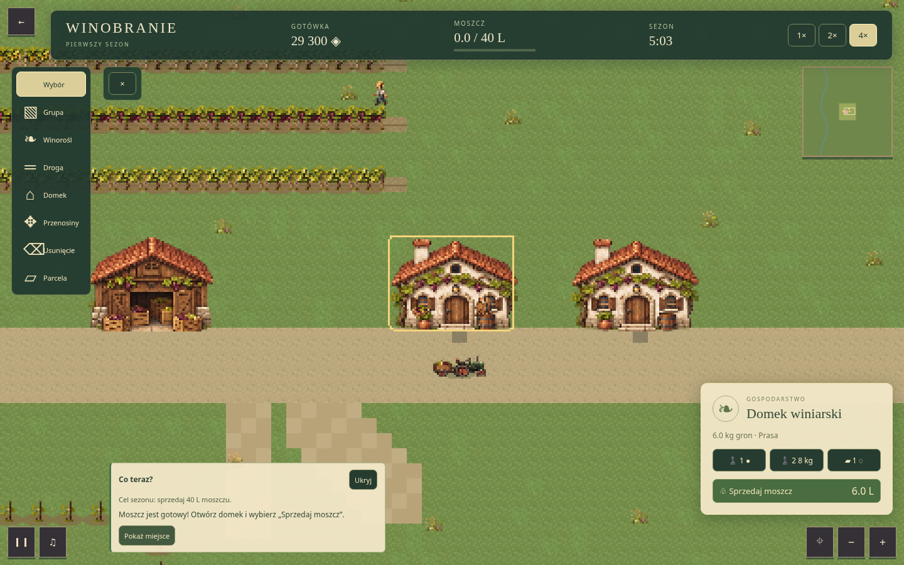

# Winobranie W1 — komunikaty „Co teraz?”, 0.9.3

14 listopada 2026. Poprawka W1 po uwadze użytkownika, że gracz może nie wiedzieć,
co zrobić w bieżącej sytuacji. Na `feature/w1-winobranie-rts` / [PR #14](https://github.com/ankelmarek/PixelForge/pull/14).
Nie rozszerza mechanik o W2.

## Zmiana

- Niewielka karta przy dolnej krawędzi podaje cel sezonu i jeden aktualny komunikat.
  Gracz może ją zwinąć i ponownie rozwinąć. Nie zatrzymuje symulacji, nie wymaga
  przeklikiwania i nie wyświetla modalnych okien.
- Na początku kieruje do budowy domku. Potem rozpoznaje budowę, zbiór,
  transport, tłoczenie, gotowy moszcz, ukończony cel, wzrost i wyczerpanie zbiorów.
- Informuje o brakującej roli pracownika, zatrzymanym traktorze, niedostępnej
  trasie i zaległościach. Podczas budowy wyjaśnia narzędzie i przyczynę odmowy.
- „Pokaż miejsce” wybiera właściwy domek albo jednostkę i przesuwa kamerę.
  Nie przydziela pracy, nie buduje ani nie wydaje pieniędzy.
- Komunikat wynika z bieżącego modelu; po wznowieniu pokazuje aktualną sytuację.
  Brak kolejki starych powiadomień i osobnego postępu samouczka w zapisie.
- Region dostępności `status` ogłasza wyłącznie zmianę treści. Nie ma migania
  ani nowych dźwięków powiadomień. Panel chowa się po zakończeniu sezonu.

Wcześniejszą zasadę braku pisanych podpowiedzi zmieniono **dla Winobrania RTS**
na wyraźne polecenie użytkownika. Wyjątek jest zapisany w AGENTS, specyfikacji
głównej, specyfikacji gry, planie wdrożenia i roadmapie. Pozostałe gry zachowują UX.
Nie zmieniono modelu ekonomii, nawigacji, formatu zapisu, engine ani kodu panelu PHP.

## Pliki

`src/games/winobranie-rts/guidance.ts` zawiera projekcję komunikatu z modelu.
`runtime.ts` przekazuje ją do istniejącego API klienta i obsługuje wskazanie
obiektu; `controls.ts` renderuje kartę. Style w `src/styles/main.css` ograniczono
do klas Winobrania. Klient ma wersję 0.1.3, pakiet PixelForge 0.9.3.

## Weryfikacja

Testy jednostkowe obejmują komunikaty podczas rzeczywistego sezonu, wznowienie,
brak ról, blokadę, priorytet sprzedaży, zaległości, zły podgląd i zakończenie.
Przeglądarkowy pełny sezon sprawdza tekst początkowy, zwijanie, odmowę budowy,
przejście do gotowej partii, wskazanie domku, sprzedaż i wznowienie.
Kontrole końcowe są w [Checks PR](https://github.com/ankelmarek/PixelForge/pull/14/checks).

Kontrole lokalne dla 0.9.3: lint/Prettier, TypeScript strict i build PASS;
89 Vitest, 15 testów paczek, 36 PHP/Python i 12 Apache/PHP PASS. Wszystkie
trzy scenariusze Playwright Winobrania przeszły (2.0 min). Oba ZIP-y zbudowano,
a walidator full potwierdził 551 plików / 16 578 623 bajtów po rozpakowaniu.
CI ponawia cały zestaw E2E oraz produkcyjne scenariusze statycznych paczek,
instalacji, rollbacku i public_html. [Widok początkowy](reports/W1-guidance-start.png).

Pierwsza próba przeglądarkowa ujawniła zasłanianie pola budowy przez kartę
w panelu bocznym; przeniesiono ją przy dolną krawędź. Osobny przebieg został
przerwany przez przeładowanie Vite podczas zmiany wersji. Podany wynik PASS
pochodzi z ponowienia na końcowych, niezmienianych w trakcie testu źródłach.

## Dystrybucja

Do działającego instalatora: `downloads/pixelforge-0.9.3-full.zip`, bez rozpakowywania.
Do pierwszej instalacji: `downloads/pixelforge-public-html-0.9.3-installer-1.2.0.zip`.
Oba zawierają cały frontend z Winobraniem, Dżdżownicą i Atlasem. Poprzednie
wydania, w tym 0.9.2, pozostają niezmienione; aktualizator nadal ma wersję 1.2.0.
Pierwsza instalacja: [instrukcja](PUBLIC-HTML-INSTALL.txt).

| Paczka                    |      Bajty | SHA-256                                                            |
| ------------------------- | ---------: | ------------------------------------------------------------------ |
| Full 0.9.3                | 13 128 701 | `4ea558a566556e6dee83546ed63ceda8d32676e8daf9119882bfc3247a41349d` |
| Public_html 0.9.3 + 1.2.0 | 13 218 987 | `e614a0001fd1b78d445e07c69506c21a46f0343971c5a35fca394825a3a01be3` |

W1 nadal dotyczy desktopu. Nie przeprowadzono nowego badania z osobami
nieznającymi gry; krótkie komunikaty nie zastępują odbioru czytelności i balansu.
