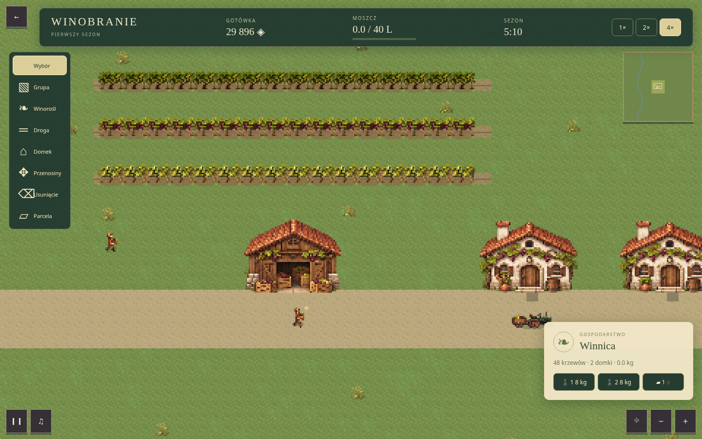

# W1 — Winobranie RTS: pierwszy sezon

> Aktualizacja po uwadze użytkownika: **0.9.3** dodaje krótkie, kontekstowe
> komunikaty „Co teraz?”. [Opis zmiany i weryfikacja](W1-GUIDANCE.md).
> Poniższy raport dokumentuje bazę W1 do 0.9.2.

14 listopada 2026 (Europe/Warsaw). Gałąź `feature/w1-winobranie-rts`, baza
`f6c4a767` / PR #13 (W0), dziedzicząca działający kod PR #12. W1a–W1d
zaimplementowano i zweryfikowano lokalnie. [PR #14](https://github.com/ankelmarek/PixelForge/pull/14) pozostaje do odbioru użytkownika. W2–W4 nie
rozpoczęto. Nie wykonano merge ani instalacji na hostingu użytkownika.

## Co działa

- Nowy, osobny klient `winobranie-rts` 0.1.2 w katalogu PixelForge 0.9.2.
  Stare `winobranie` z PR #4 pozostaje nieaktywne.
- 8192 × 8192 px, 256 sektorów po 512 px; streaming RLE, culling sprite'ów,
  minimapa, przeciąganie kamery, zoom 0.5–2 z wyrównaniem do pikseli.
- Start: 30 000 monet, 48 dorosłych krzewów, Solaris/Regent/Johanniter,
  dwóch ludzi, jeden traktor i magazyn. Dwa uprawnienia do budowy domków.
- Swobodne linie rzędów i dróg, obrót domku, podgląd kosztu i dostępności.
  Walidacja całej powierzchni: własność, kolizje, stromy teren, dojście ludzi
  i prześwit 3 × 3 dla traktora. Zły/anulowany/stary preview niczego nie pobiera.
  Zakup sąsiedniej parceli, usunięcie nasadzeń i przeniesienie pustego domku.
- Ludzie wykonują budowę/sadzenie, zbiór i pracę przy prasie. Role Auto,
  Zbiór, Budowa, Prasa, Postój. Wybór pojedynczy lub prostokątem; wszystkie
  potrzebne akcje dostępne myszą. Anulowanie pracy zachowuje ładunek.
- Grona są rezerwowane, zbierane, niesione do magazynu, ładowane na traktor,
  przewożone do dostępnego doku i tłoczone. Prasa potrzebuje pracy operatora;
  wsad i produkt mają własny bilans. Sprzedaż usuwa moszcz dokładnie raz.
- Nowe sadzonki wymagają posadzenia i 120 s wzrostu; pierwszy plon wynosi
  0.2 kg/krzew wobec 2 kg dorosłych krzewów startowych. To uproszczenie W1,
  pełna agronomia jest zakresem W2.
- Zegar 50 ms, tempo ×1/×2/×4, opłaty dzienne. Finał po 360 s symulacji:
  sukces przy sprzedaży ≥40 L i braku zaległości; w przeciwnym razie
  podsumowanie niedokończonego celu. Wynik obejmuje przychód, koszty i straty.
- Osobny zapis `pixelforge:client:v1:winobranie-rts`: praca, ładunki, partie,
  ekonomia, drogi, nasadzenia, zegar i tempo. Odtworzenie waliduje całość przed
  podmianą aktywnego modelu. Uszkodzony zapis daje komunikat techniczny.
- Oryginalne atlasy pixel art, animacja pracy/ruchu, skrzynki/beczki,
  podgląd doku, efekty syntezowane i muzyka z wyciszeniem. Brak tekstowego
  tutorialu i nowych zależności runtime. [Pochodzenie](../public/assets/games/winobranie-rts/LICENSE.md).

## Zmiany współdzielone

`engine/api/strategy` udostępnia generyczne zegar, ledger, inventory,
rezerwacje, geometrię i regionalny navigator. `TerrainWorld` nie wymaga
fikcyjnych aktorów ani receptur. Indeks budowany jest porcjami podczas
ładowania; edycja aktualizuje dotknięte regiony i portale, z halo pojazdu.
Podgląd używa kopii indeksu współdzielącej niezmienne regiony; przeniesienie
aktualizuje osobno stare i nowe miejsce. Trasy poza edycją pozostają ważne.
Trasa zablokowana zachowuje pracę/ładunek i jest ponawiana po zmianie topologii.

Opcjonalne `createControls`, `client-action`, projekcja `Snapshot.client`,
lista `results` i preferowany gęstszy viewport są niezależne od nazwy gry.
Aplikacja zachowuje wspólną pauzę, minimapę i cleanup. `VersionedSave.inspect`
rozróżnia brak i uszkodzenie zapisu. [Kontrakt](CLIENT-API.md).

Najpierw zapisano neutralne testy kontraktowe i potwierdzono ich błąd przy
braku usług; potem wdrożono kod. Testy architektury nadal zabraniają importów
silnik → gry i użycia prywatnych modułów silnika przez gry. Zakaz dawnego
Winobrania został zawężony do dokładnego ID, bez zakazu nowego produktu.

## Weryfikacja

| Kontrola                                        | Wynik                                                   |
| ----------------------------------------------- | ------------------------------------------------------- |
| TypeScript strict                               | PASS                                                    |
| ESLint + Prettier                               | PASS                                                    |
| Vitest                                          | 85 PASS                                                 |
| Paczki U0 (Python)                              | 15 PASS                                                 |
| Aktualizator/panel (PHP/Python)                 | 36 PASS                                                 |
| Hosting Apache/PHP                              | 12 PASS                                                 |
| Build produkcyjny                               | PASS; istniejące ostrzeżenie Vite o dużym module Phaser |
| Playwright — cały projekt                       | 45 PASS, 5 pominięć zgodnie z platformą                 |
| ZIP w `/` i `/PixelForge/`                      | PASS                                                    |
| Panel: instalacja, rollback, ponowna instalacja | PASS                                                    |
| Zestaw `public_html` przez HTTPS/Apache         | PASS                                                    |

Osobny pełny przebieg W1 przez prawdziwy UI już przeszedł: dwa domki,
droga, rząd Regent, rzeczywista produkcja, pauza, wznowienie w trakcie pracy,
sprzedaż ≥40 L i finał. Test trwa około 1.7 min przy ×4 i nie dopisuje zasobów
ani pieniędzy. Zapis Dżdżownicy pozostaje nietknięty. Dodatkowe E2E sprawdzają
anulowanie gestu, dalekie sektory, minimum zoomu, brak atlasu/sektora,
błędny scenariusz i uszkodzony save. Model przechodzi 7200 ticków oraz kontrolę
bilansu podczas zbioru/transportu, odtworzenie w trakcie pracy, obrót/przenosiny,
x1/x4, rezerwacje, pełne wyjście receptury i niepoprawne referencje zapisu.

## Pomiar

Chromium 158.0.8127.18, Linux, headless/software rendering, 1440 × 900,
zoom 0.5, tempo ×4, 48 krzewów, 2 domki i 3 jednostki. Próbka 6 s po
rozgrzaniu sceny: średnio 60.0 FPS, p95 klatki 16.8 ms. Maksymalny zmierzony
podgląd budowy 11.7 ms; aktualizacja modelu w klatce 1.9 ms. Około 11.3 MiB
retained JS heap, 84 sprite'y, 20 MiB tekstur terenu, 20 rezydentnych sektorów,
zero brakujących sektorów/błędów. Dwa źródłowe atlasy zajmują dodatkowo około
12 MiB RGBA; pomiar nie obejmuje wszystkich buforów GPU/przeglądarki.
[Surowy wynik](reports/W1-performance.json).

To pomiar konkretnego wycinka, nie gwarancja FPS na innych komputerach ani
test docelowej kampanii z dziesiątkami jednostek. Przeglądarka i PHP działają
w środowisku testowym; nie wykonano testu na prawdziwym telefonie/LiteSpeed.

## Granice W1 i dalszy odbiór

- W1 trwa 6 minut przy ×1, a nie 30–35 minut. Nie ma jeszcze fermentacji,
  butelkowania, przymrozków, zraszaczy, sześciu odmian ani trzech lat.
- W1 nie sprzedaje dodatkowych domków, ludzi ani traktorów. Zakup sąsiedniej
  ziemi i budowanie są przygotowaniem przestrzeni; pełny rozwój to W2/W3.
- Jednostki mają miękkie mijanie (nie blokują sobie komórek). Zasoby i stanowiska
  prasy/budowy są rezerwowane; nie deklarujemy pełnego systemu unikania tłoku.
- Trasy są zapisywane jako walidowana pozostała sekwencja legalnych sąsiadów,
  zamiast odtwarzania z samego celu. Pozwala to wznowić ruch między komórkami
  bez zmiany dalszego przebiegu. Zmiana topologii przelicza dotkniętą trasę.
- Odbiór interfejsu strategii dotyczy desktopu. Regresja dotyku Dżdżownicy/Atlasu
  jest obowiązkowa; obsługa całej nowej strategii na telefonie pozostaje później.
- Nie przeprowadzono badania 3–5 nowych graczy. Czytelność bez instrukcji i
  balans W1 wymagają odbioru użytkownika przed rozpoczęciem W2.

## Paczki i GitHub

`pixelforge-0.9.2-full.zip` zawiera cały frontend (W1 + Dżdżownica + Atlas)
i manifest full v1 / engineSchemaVersion 2. Do skonfigurowanego panelu
przesyła się ten ZIP bez rozpakowywania. Zestaw
`pixelforge-public-html-0.9.2-installer-1.2.0.zip` służy pierwszej instalacji
w `public_html`. Aktualizator 1.2.0 oraz poprzednie ZIP-y pozostają niezmienione.
Sumy SHA-256 są obok archiwów w `downloads/`.

[PR #14](https://github.com/ankelmarek/PixelForge/pull/14), bez merge.
Oba ZIP-y są w repozytorium wraz z plikami sum SHA-256.

| Paczka                    |      Bajty | SHA-256                                                            |
| ------------------------- | ---------: | ------------------------------------------------------------------ |
| Full 0.9.2                | 13 126 023 | `a69a7e21010960bf725ad8cef2a5c24c55c7e3a2822b62ea23beeffa6d30920f` |
| Public_html 0.9.2 + 1.2.0 | 13 216 311 | `17410c6663e8e085a97c2ee16933b4fdc46f4e6448e6a32a47090409083bf95e` |

Walidator potwierdził 551 plików full ZIP, 16 571 313 bajtów po rozpakowaniu.
Archiwa full/startowe 0.8.0 mają identyczne SHA-256 jak w W0.
Wszystkie testy dystrybucji przeszły. [Statyczny ZIP](reports/W1-GAME-BROWSER-RESULTS.json):
Dżdżownica na desktopie/emulacji telefonu pod `/` i `/PixelForge/`;
Winobranie na desktopie w obu ścieżkach, budowa, fizyczna produkcja i resume.
[Panel HTTPS](reports/W1-INSTALLER-BROWSER-RESULTS.json): instalacja
0.6.1 → 0.9.2, rollback → 0.6.1, ponowna instalacja → 0.9.2, wznowienie
Dżdżownicy i Winobrania, izolacja save i brak błędów JS/HTTP.
[Public_html](reports/W1-HOSTING-BROWSER-RESULTS.json): konfiguracja,
403 prywatnego katalogu, instalacja/rollback, desktop, emulacja telefonu i no-JS.
Przyszły numer 0.9.3 w tym teście jest wyłącznie tymczasowym fixture
z niezmienioną zawartością gry, nie opublikowanym wydaniem.

Kontrole GitHub Actions są dostępne w [zakładce Checks PR](https://github.com/ankelmarek/PixelForge/pull/14/checks).
Powyższe liczby opisują ukończone kontrole lokalne. Pełną regresję wykonano
na 0.9.0; 0.9.1 przeszła także cały workflow GitHub Actions. Zakres lokalnego
ponowienia po poprawce 0.9.2 opisano poniżej, a CI ponawia cały zestaw.

## Główne pliki

- `src/engine/world/navigation.ts`, `simulation/types.ts`, `strategy/services.ts`,
  `api/strategy.ts`: neutralne kontrakty, indeks terenu i transakcje.
- `src/engine/api/client.ts`, `core/viewport.ts`, `systems/versioned-save.ts`,
  `src/app/game.ts`: rozszerzenia publicznego klienta i prezentacji.
- `src/games/winobranie-rts/`: osobne model, walidacja świata, runtime,
  renderowanie, panele i definicja. `src/games/registry.ts` rejestruje klienta.
- `public/assets/games/winobranie-rts/`, `tools/generate-winery.py`: grafika,
  deklaracja scenariusza, sektory i generator danych.
- `tests/unit/strategy.test.ts`, `winery.test.ts`, `viewport.test.ts`,
  `tests/e2e/winery.spec.ts`: kontrakty, bilans, zapis i pełny przebieg UI.
- Testy `packages`, `updater`, `hosting`, workflow CI i `downloads/`: kontrola
  produkcyjnego wydania i kompatybilności panelu.

Nie zmieniono źródeł Dżdżownicy, Atlasu ani aktualizatora. Drobne zmiany
w istniejących testach ograniczają zakaz do dokładnego starego ID oraz
wybierają nowe archiwum, zachowując poprzednie kryteria regresji.

### Poprawka 0.9.1

Test regresji wykazał, że punkt pracy pionowego rzędu wyznaczanego z góry
w dół wypadał na krzewie. Wybór osiągalnego sąsiedniego punktu usuwa
zależność od kierunku gestu; unit obejmuje oba kierunki, E2E sadzi również
pionowy rząd. Finał jest zapisywany natychmiast i zatrzymuje akumulator zegara.
Archiwa 0.9.0 zachowano bez zmiany bajtów, a opisany przyrost opublikowano
jako osobne wydanie 0.9.1. Pomiar renderera wykonano na 0.9.0 przed tą poprawką;
renderer i grafika nie zmieniły się w 0.9.1.

Po poprawce ponownie przeszły wszystkie 84 testy Vitest, trzy scenariusze
Playwright Winobrania (2.0 min), build, lint/typecheck, walidacja nowych ZIP-ów,
12 testów hostingu i pełne przeglądarkowe scenariusze paczek/install/rollback
na 0.9.1. Pełna regresja 45 + 5 została wykonana przed poprawką klienta;
workflow PR ponawia cały zestaw na końcowym commicie.

### Poprawka 0.9.2 — prześwit ukośnej drogi

Ukośny odcinek rysowany pędzlem 3×3 wymaga także obu ortogonalnych
komórek w narożniku. Bez nich widoczne kafle łączyły się po przekątnej,
ale pojazd 3×3 nie miał ciągłej trasy w grafie czterech sąsiadów. Pędzel
uzupełnia teraz narożniki przed obliczeniem powierzchni, własności i ceny.
Nowy test sprawdza cztery kierunki, przeciąganie w obie strony oraz porty
obróconych domków; E2E maluje także odcinek ukośny. Nie zmieniono renderera,
panelu PHP ani formatu zapisu. Poprzednie archiwa 0.9.0/0.9.1 pozostają
niezmienione, bieżące wydanie to 0.9.2.

Na 0.9.2 ponownie przeszły lint/typecheck, build, 85 testów Vitest,
trzy scenariusze Playwright Winobrania (2.0 min), walidacja obu nowych ZIP-ów
i 12 testów hostingu. Przeglądarkowe testy produkcyjnych paczek, panelu
instalacji/rollbacku oraz zestawu public_html zakończyły się bez błędów.
Dołączone raporty JSON dystrybucji dotyczą właśnie 0.9.2.
