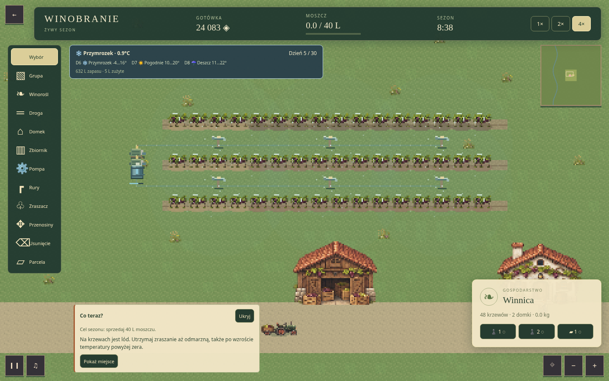

# Winobranie RTS — W2: żywy sezon, PixelForge 0.10.0

14 listopada 2026, Europe/Warsaw. Na polecenie „ok, teraz rozwiń grę,
zróżnicuj, losuj, zrób ciekawszą” po W1. Gałąź
`feature/w2-winobranie-seasons`, baza `b5c80d1` z PR #14 (0.9.3).

W2 rozwija uprawę i pogodę; trzyletnia kampania, zatrudnianie, zakup floty
i fermentacja pozostają zakresem W3. PR bez automatycznego scalenia i wdrożenia.

## Co zmieniło się w grze

- Nowy sezon trwa 600 sekund symulacji, czyli 10 minut przy ×1. Prędkości
  ×2/×4 i pauza pozostają dostępne. Cel: sprzedać 40 L moszczu, bez zaległości.
- Nowa gra losuje 32-bitowy seed z przeglądarki. Seed wyznacza odmiany trzech
  dorosłych rzędów, gleby, nasłonecznienie, pogodę i epizody mrozu/suszy.
  Wznowienie zachowuje seed. Prognoza nie zużywa stanu generatora.
- Sześć odmian: Solaris, Regent, Johanniter, Muscaris, Rondo, Cabernet Cortis.
  Różnią się ceną sadzonki i moszczu, sumą ciepła do zbioru, potencjałem plonu
  oraz podatnością na mróz, suszę i mączniaka. W panelu odmiany widać profil
  i ceny przed zakupem.
- Pąki → kwitnienie → zawiązanie → dojrzewanie → zbiór/spoczynek. Rozwój
  zależy od ciepła, słońca i wilgoci. Młode nasadzenie daje 10% potencjalnego
  plonu; dane obsługują wiek 1 (55%) i dorosłe 2–3 (100%). W tym jednym
  sezonie wiek nie przeskakuje na kolejny rok. Każdy fragment rzędu plonuje raz.
- Piasek, glina i próchnica mają różną retencję, a mikroklimat zmienia lokalną
  temperaturę. Fragment obejmuje do czterech krzewów; pełne rzędy są agregowane,
  bez niezależnego obiektu symulacji dla każdego liścia czy owocu.
- Pogoda zmienia się w 30 umownych dniach (20 s/dzień). Prognoza obejmuje 1–3 dni,
  z szerszym zakresem temperatur i niższą pewnością dla dalszego terminu.
  Wiosną występuje 1–2 epizodów mrozu; letnia susza zaczyna się w losowym dniu.
- Zbiornik, pompa, podziemne rury i zraszacze tworzą dynamiczny graf. Zasięg
  zraszacza widać przy budowie i zaznaczeniu. Rury mogą przecinać rzędy/drogi;
  urządzenia blokują pojedyncze pole i przechodzą kontrolę dojścia.
- Auto reaguje na mróz, lód i przesychającą glebę. Ciągle podaje wodę bez przerw;
  Wyłączony zatrzymuje dane urządzenie. Zbyt mały przepływ, odcięta rura,
  pusta beczka lub brak pieniędzy na energię zmniejszają ochronę. Krótki oprysk
  nie ratuje upraw; przerwanie ochrony oblodzonych pąków zwiększa uszkodzenia.
- Pąki tracą zdrowie od temperatury, czasu ekspozycji i fazy wzrostu. Oblodzenie
  znika dopiero po 10 sekundach lokalnej temperatury co najmniej +1°C.
  Odmarzanie trwa także wtedy, gdy gracz patrzy na inną część mapy.
- Susza ogranicza wzrost i zdrowie. Nadmiar wilgoci sprzyja uproszczonemu
  mączniakowi. Pielęgnacja kosztuje 100 monet i wymaga dojścia oraz 6 sekund
  pracy człowieka w Auto/Budowa; ogranicza chorobę, nie cofa strat od mrozu.
- Krótkie komunikaty podpowiadają przygotowanie instalacji, uzupełnienie wody,
  ochronę przed mrozem i pielęgnację. „Pokaż miejsce” obsługuje również rząd
  i urządzenie. Pozostają zwijane i wynikają z aktualnego stanu.
- Proceduralne, małe sprite'y instalacji wodnej, strumienie, deszcz, szron,
  zmiany krzewów i barw gleby. Alarm przymrozku korzysta z istniejącego audio.
  Teren nadal używa sektorów, filtrowania NEAREST i dotychczasowej korekty zoomu.

## Parametry i bilans

Zbiornik kosztuje 1200 monet, mieści 1000 L i zaczyna ze 100 L. Zamówienie
uzupełnia do 500 L w 20 sekund symulacji, po opłaceniu 1 monety/L; nie można
zamówić równoległej dostawy ani rozebrać zbiornika w trakcie dostawy.
Deszcz dodaje 1–3 L/s, do pojemności z uwzględnieniem zamówienia.

Pompa kosztuje 1000 monet, daje 2 L/s i kosztuje 0,20 monety/s aktywnej pracy.
Zraszacz kosztuje 300 monet, obejmuje promień 7 pól i potrzebuje 0,24–0,36 L/s
zależnie od wiatru. Rura kosztuje 4 monety/pole. Przepływ jest dzielony między
odbiorniki w komponencie; nakładające się zasięgi nie mnożą ochrony. Limity:
4 zbiorniki, 4 pompy, 24 zraszacze, 2048 pól rur.

Woda: `zapas + zużyta + usunięta = dostarczona + deszcz`. Dostawa staje się
zasobem dopiero po upływie czasu. Energia jest naliczana w tickach pomp
i rozliczana co sekundę. Grona: faktycznie wyprodukowane zasoby nadal bilansują
się między rzędami, pracownikami, magazynem, traktorem, prasą i stratami.
Utracony potencjał plonu to osobna liczba, bez dodawania nieistniejących gron.

Wszystkie parametry agronomiczne są uproszczeniem rozgrywki, nie instrukcją
prowadzenia rzeczywistej winnicy. Dostawa wody jest usługą z opóźnieniem;
nie dodaje nowej jednostki-cysterny. Cukier/kwasowość z katalogu są danymi pod
późniejsze partie jakościowe; W2 rozlicza moszcz według odmiany.

## Zapis i architektura

Nowy klucz: `pixelforge:client:v2:winobranie-rts`, stan `version: 2`, rewizja
symulacji `vineyard-w2`. Geometria sektorów zachowuje rewizję `vineyard-w1`.
Gdy nie ma v2, zwalidowany v1 jest migrowany do v2 z `environment: null`:
kończy stary sezon 360 s według reguł W1, bez dopisywania mrozu do rozpoczętej
partii. Stary klucz jest tylko odczytywany i pozostaje do rollbacku. Uszkodzony
v2 nie powoduje cichego cofnięcia do v1. Nowa gra uruchamia pełne W2.

Zapis zawiera seed, wzrost i zdrowie fragmentów, lód/odmarzanie, zlecenia
pielęgnacji, urządzenia i ich tryby, rury, wodę, oczekujące dostawy i energię.
Walidator sprawdza zakresy, tożsamości, geometrię, referencje, fazy oraz bilanse;
odtworzenie publikuje stan dopiero po sprawdzeniu tras. Indeksy wody i nawigacji
są odtwarzane, a prognoza wyliczana z seeda/ticka.

Silnik otrzymał neutralny sampler i oś zdarzeń w `engine/strategy/climate.ts`
(publiczne API `engine/api/strategy`). Cała agronomia, treści, pogoda winnicy,
reguły sieci wody, sterowanie i wizualizacja pozostają w `games/winobranie-rts`.
Kod Atlasu, Dżdżownicy oraz serwerowego aktualizatora jest zachowany.

## Weryfikacja

Lokalnie: lint/Prettier, TypeScript strict i build PASS; 100 Vitest, 15 testów paczek,
36 PHP/Python i 12 Apache/PHP PASS. Cztery scenariusze Playwright Winobrania
przeszły, w tym pełny sezon W2 sterowany myszą oraz pełny stary sezon po
migracji W1. Pełna lokalna regresja przeglądarkowa: **46 PASS, 6 pominięć zgodnych
z platformą**, 9 minut. CI ponawia cały zestaw i scenariusze produkcyjnego ZIP-a
pod `/` i `/PixelForge/`, panelu oraz instalacji `public_html`. Wynik końcowego
commita: [Checks gałęzi W2](https://github.com/ankelmarek/PixelForge/actions?query=branch%3Afeature%2Fw2-winobranie-seasons).

Testy jednostkowe obejmują sześć odmian, deterministyczną
pogodę i prognozę, pełny sezon, bilans gron/wody/energii, zapis w mrozie, ×1/×4,
migrację W1 i odrzucenie uszkodzeń. Porównanie mrozu sprawdza pełny strumień,
brak ochrony, oprysk jednosekundowy, wyczerpanie zbiornika, wyłączenie pompy,
przerwaną rurę, przedwczesne wyłączenie podczas odmarzania, przeciążenie pompy
ośmioma zraszaczami oraz brak energii. Osobno sprawdzono wznowienie w trakcie
odmarzania, mniejszy plon młodych krzewów i długą suszę. Pełny sezon z ochroną,
uzupełnianiem wody i pielęgnacją osiąga cel dla seedów 1, 42, 731, 2026 oraz
4294967295; wyniki zbioru różnią się. To próby balansu, nie dowód dla wszystkich seedów.

E2E W2 buduje dwa domki, zbiornik, dwie pompy i sześć zraszaczy, układa rury,
zamawia wodę, przyspiesza czas, zapisuje przymrozek, odświeża stronę i kontynuuje.
Kamera jest odsuwana do odległych sektorów, a zużycie wody nadal rośnie.
Pielęgnacja i sprzedaż prowadzą do wyniku po 12000 tickach bez błędów JS.
[Wynik sezonu](reports/W2-result.png).

Odbiór pełnego RTS W2 obejmuje komputer. Regresja mobilna dotyczy Atlasu
oraz Dżdżownicy. Testy Chromium w kontenerze nie zastępują badania z nowymi
graczami ani pomiaru na rzeczywistym telefonie. W3/W4 pozostają osobnymi etapami.

## Dystrybucja

- `downloads/pixelforge-0.10.0-full.zip` — aktualizacja przez istniejący panel
  U2 lub ręczne wgranie kompletnej zawartości na serwer statyczny.
- `downloads/pixelforge-public-html-0.10.0-installer-1.2.0.zip` — pierwsza
  instalacja całego środowiska w `public_html`; nie wgrywać jako aktualizacji gry.

W aktualizatorze wybierz pełny ZIP, „Sprawdź pakiet” i „Zainstaluj wydanie
0.10.0”. Otwórz `/PixelForge/index.html`. Dla nowych mechanik wybierz Nowa gra;
Wznów zachowuje wcześniej rozpoczęty sezon. Nie wdrożono na hosting użytkownika.

Walidator full potwierdził **551 plików / 16 609 379 bajtów po rozpakowaniu**,
zgodność każdej zawartości z `dist` oraz integralność archiwów. Stare paczki
0.9.3 zachowują wcześniejsze SHA-256.

| Archiwum                                            |  Bajty ZIP | SHA-256                                                            |
| --------------------------------------------------- | ---------: | ------------------------------------------------------------------ |
| `pixelforge-0.10.0-full.zip`                        | 13 139 647 | `e0a88b378c708b4784c8781fd08bb9ba8b0db7cb79ebed851991313b2098ec3c` |
| `pixelforge-public-html-0.10.0-installer-1.2.0.zip` | 13 229 926 | `4adcd52a2ab0a9ceb29875d9b9486209e207d6ee9c8ad4db2124fe98c69404ad` |
