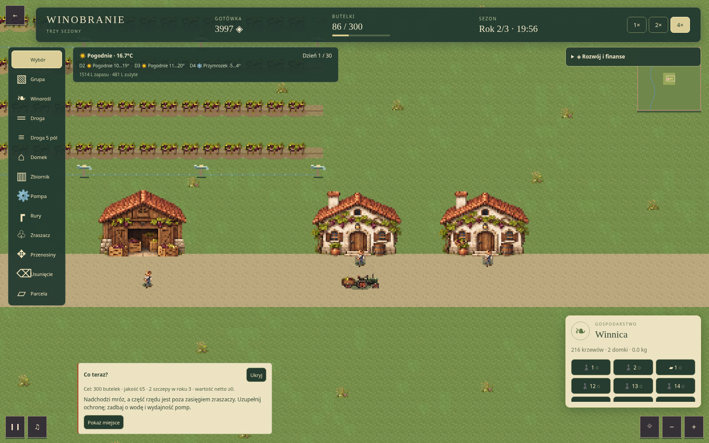
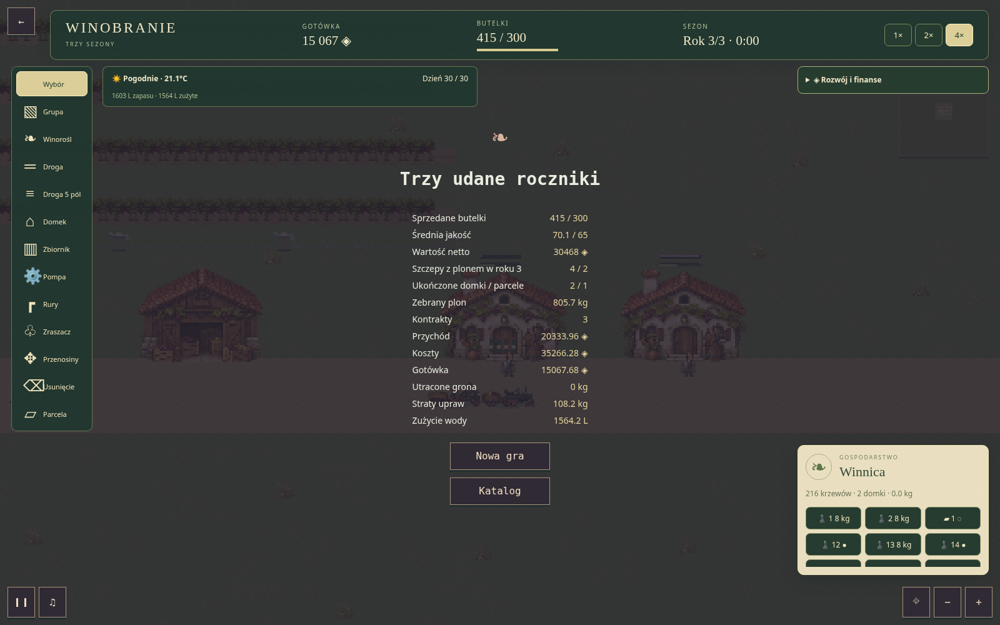

# Winobranie RTS — W3: trzy roczniki, PixelForge 0.11.0

14 listopada 2026. Polecenie: „Rób nowy zakres”, po dostarczeniu W2.
Gałąź `feature/w3-winobranie-campaign`, baza `3fdb6f9` / PR #15.
Sprawdzono otwarty PR #15 i jego zakończone sukcesem pełne CI. Dokumentacyjny
`main` nadal nie zawiera połączonego stosu kodu. W3 ma własny PR; nie scala
poprzednich PR do `main` i nie instaluje gry na hostingu użytkownika.

Status: **REVIEW — implementacja i kontrole lokalne zakończone**.
Wynik pełnego CI jest dołączany do PR bieżącej gałęzi. W4 nie rozpoczęto.

## Kampania i rozwój

Nowa gra uruchamia trzy automatyczne roczniki po 12000 kroków po 50 ms
(600 s). Całość to 1800 s przy ×1, bez pauz. Tempo ×2/×4 wykonuje te same
kroki. Cel 30–35 minut z zarządzaniem nadal wymaga pomiarów z nowymi graczami
w W4; sama długość zegara nie zastępuje playtestu.

Na przełomie roku pogoda otrzymuje nowy deterministyczny strumień, krzewy
starzeją się (10% → 55% → 100% potencjału), a ich wzrost zaczyna nowy cykl.
Niezebrane grona stają się jawną stratą. Zebrane zapasy, ładunki, wino,
budynki, infrastruktura i rozpoczęte procesy przechodzą do kolejnego roku.
Partie różnych odmian i roczników nie są łączone.

Po dwóch darmowych uprawnieniach kolejne domki kosztują 8000 monet.
Przenosiny kosztują 1000 i wymagają pustego budynku. Ukończony pusty domek
można zlikwidować za 4000. Ulepszenia: prasa za 3500 skraca pracę i tłoczenie
dwukrotnie; pojemność za 2500 zwiększa fermentator z 12 do 24 L i magazyn
butelek ze 128 do 256; kontrola za 3000 daje +6 punktów jakości.
Własne nasadzenia, drogi i zakup sąsiednich parcel pozostają dostępne.

| Zakup              | Cena | Koszt/dzień | Ładunek | Ruch w polach/s |
| ------------------ | ---: | ----------: | ------: | --------------: |
| Pracownik stały    |  250 |           8 |    8 kg |               5 |
| Pracownik sezonowy |  100 |          12 |    8 kg |             5,5 |
| Mały traktor       | 4500 |           4 |   24 kg |               9 |
| Mocny traktor      | 7500 |           7 |   36 kg |              12 |
| Duża przyczepa     | 9500 |           9 |   48 kg |               8 |

Sezonowy kończy pracę po roczniku. Zwalniany człowiek lub sprzedawany traktor
najpierw oddaje ładunek; pojazd zwraca połowę ceny. Domek kosztuje dodatkowo
3 monety/dzień. Auto/Prasa obejmuje też butelkowanie. Duża przyczepa ma profil
5×5, odrębny indeks nawigacji i dłuższą pauzę przy zmianie kierunku; potrzebuje
narzędzia „Droga 5 pól”. Walidacja edycji i zapisu obejmuje jej przejazd.
Dok załadunku/rozładunku jest rezerwowany, transport zachowuje fizyczny ładunek.
Wskazanie domku pustemu traktorowi przypisuje dostawy; Auto usuwa przypisanie.

## Partie, jakość i kontrakty

Grona → tłoczenie → moszcz → fermentacja → wino → butelkowanie przez
pracownika → sprzedaż. LotBook przechowuje ID partii, odmianę, rocznik,
właściciela, ilość i pochodzenie z rzędu/rocznika. Podział i łączenie
zachowują całkowite ilości oraz sumę ważoną jakości. Zmiana właściciela nie
poprawia jakości i nie duplikuje zasobu.

1000 g gron daje 600 ml moszczu. Fermentacja oddaje 95% objętości jako wino,
pozostałe 5% jest jawną stratą technologiczną. Butelka zużywa 750 ml;
reszta zostaje w zgodnej partii. Gramów nie dodajemy do mililitrów.
Pełny magazyn zatrzymuje dalszą produkcję, zamiast kasować wynik. Po sprzedaży
butelkowanie pozostałego wina rusza bez oczekiwania na nowy moszcz; pracownik
jest zwalniany na czas blokady. Osobny test sprawdza częściowo zapełniony
magazyn, pozostałą objętość, czekanie i dokończenie po sprzedaży.

Jakość wynika z odmiany (cukier/kwasowość), zdrowia pąków i mączniaka.
Młode wino fermentuje 30 s, rezerwa 90 s i daje +10 jakości. Kontrola daje +6.
Zmiana trybu dotyczy następnej partii. Fermentator gromadzi minimum 6 L
jednej odmiany/rocznika; w ostatnich 180 s rocznika przyjmuje też mniejsze
pozostałości. Większy zbiornik pozwala przyjąć większą dostępną partię.

Cena butelki zależy od odmiany, jakości i rynku rocznika (90–110% ceny).
Co roku można przyjąć jeden kontrakt: większą dostawę o jakości ≥60 albo
mniejszą kolekcję ≥75. Zgodne butelki dostają premię 25% do ilości kontraktu.
Niewykonanie do końca roku kosztuje 200 monet. Kontrakt nie tworzy zasobów.

## Finanse i finał

Płace i utrzymanie naliczane są co 400 kroków, także poza kamerą.
Można sprzedać grona z magazynu za 10 monet/kg albo wcześniej sprzedać
płynne zapasy. Jedna pożyczka daje 5000 monet, wymaga 5500 w ciągu roku
i może być spłacona wcześniej. Kapitał nie jest przychodem; odsetki są kosztem.
Po terminie spłata następuje, gdy są środki. Zaległości są widoczne.
Przed wczesną porażką obowiązuje ostrzeżenie przez trzy dni i sprawdzenie
możliwości ratunku: pożyczki, odbudowy, zapasów, upraw i aktywów.
Sam mróz albo chwilowy brak gotówki nie kończy kampanii.

Wygrana wymaga łącznie 300 sprzedanych butelek, jakości sprzedaży ważonej
liczbą butelek ≥65/100, nieujemnej wartości netto oraz dwóch nadal obecnych
szczepów, które wydały plon w roku 3. Netto to gotówka i zachowawcza wycena
zapasów/aktywów pomniejszona o dług i zaległości. Niewykończone partie nie
dają punktów za sprzedaż. Działająca winnica bez kompletu celów osiąga częściowy
sukces; brak możliwości kontynuacji prowadzi do porażki. Finał jest trwały
i zatrzymuje symulację, także po wznowieniu.

W0 proponowało 500 butelek jako wartość do zbalansowania. W3 przyjmuje 300,
zostawiając miejsce na szkody, logistykę i dłuższą produkcję jakościową.
Cel wymaga nowych nasadzeń i inwestycji; mała startowa winnica go nie osiąga.
Parametry są w `campaign.ts`, reguły produkcji w `production.ts`.

## Sprawdzone strategie

Test porównał 64 ziarna wyłącznie według łącznej dawki mrozu przez trzy lata.
Wszystkie trzy polityki rozegrały dwa skrajne przebiegi: seed 49 (najmniejsza
dawka, minimum powietrza −1,9°C) i 1 (największa, −3,2°C). Mikroklimat dodaje
lokalną różnicę. Polityki reagują na stan wody/upraw i czas, nie znają przyszłej
pogody. Nie dopisują pieniędzy, nie teleportują plonu i nie skracają receptur.

| Strategia                          | Seed | Butelki | Jakość |    Netto | Wynik  |
| ---------------------------------- | ---: | ------: | -----: | -------: | ------ |
| Wczesny plon i drugi traktor       |   49 |     422 |  68,11 | 31429,51 | sukces |
| Wczesny plon i drugi traktor       |    1 |     420 |  67,25 | 32752,33 | sukces |
| Premium, trzeci domek i ulepszenia |   49 |     311 |  79,67 | 15091,66 | sukces |
| Premium, trzeci domek i ulepszenia |    1 |     333 |  77,86 | 15875,16 | sukces |
| Sześć odmian i wspólna ochrona     |   49 |     369 |  68,99 | 32214,25 | sukces |
| Sześć odmian i wspólna ochrona     |    1 |     377 |  67,59 | 34117,01 | sukces |

Każda sadzi siedem rzędów w pierwszej wiośnie, zatrudnia ekipę i utrzymuje
instalację wody. Premium finansuje trzeci domek pożyczką; na ostatnie 150 s
wybiera krótszą produkcję kolejnych partii. Każda ukończyła trzy kontrakty.
To próby balansu, nie gwarancja wyniku dla wszystkich seedów ani odbiór przez
ludzi. [Zapis wyników](reports/W3-campaigns.json) pochodzi z testu;
kolejne uruchomienia trafiają do `work/w3/campaigns.json` i artefaktów CI.

## Zapis i zmiany techniczne

Klucz `pixelforge:client:v3:winobranie-rts`, rewizja `vineyard-w3`.
V1/V2 są walidowane i migrowane do trybu zgodności: 360/600 s i moszcz.
Stare klucze pozostają do rollbacku. Uszkodzony v3 nie cofa do v2/v1.
Nowa gra zawsze uruchamia W3. Odtworzenie całego stanu jest atomowe.

Walidator sprawdza właścicieli partii, jakość, bilans każdego etapu,
odwołania, rezerwacje, zatrudnienie, finanse, kalendarz i wynik. Limity:
24 jednostki, 64 rzędy, 32 domki, 2048 aktywne partie, 1,5 mln znaków zapisu.
Budżety świata i cache sektorów nie wzrosły.

Silnik dostał neutralny `LotBook` i opcjonalny tytuł wyniku klienta.
Nawigacja porządkuje portale według geometrii: kolejność ich przebudowy
nie zmienia trasy po wczytaniu. Test obejmuje neutralny graf i cały model
×1/×4/zapis. Rozdzielono rezerwację pracy przy rzędzie od ilości plonu.
Reguły winiarskie pozostają w katalogu klienta.

Nowe moduły: `campaign.ts`, `production.ts`, `campaign-validation.ts`,
`campaign-view.ts`, `campaign-guidance.ts`, `engine/strategy/lots.ts`.
Integracja w modelu, runtime, panelach i widoku. Grafika W3 pokazuje butelki,
fermentację oraz warianty floty. Bez nowych zależności runtime. Kod Dżdżownicy,
Atlasu i serwerowego aktualizatora pozostaje zachowany.

## Weryfikacja i dystrybucja

Lint/Prettier, TypeScript strict, build i walidacja full ZIP PASS.
115 Vitest PASS: pełne kampanie, częściowy sukces, niewypłacalność/ratunek,
zakup/utrzymanie/pożyczka, partie i uszkodzenia, przejścia roczników,
wznowienie, pauza, ×1/×4 oraz regresja W1/W2 i innych gier. Test granicy
niewypłacalności używa syntetycznego obciążenia; nie jest jedną z sześciu
kampanii porównawczych. Test pojemności produkcji korzysta z izolowanego
stanu magazynu. Wszystkie sześć kampanii ponowiono po tej poprawce;
wyniki w tabeli pozostały identyczne.

Playwright lokalnie: 1 pełna kampania W3 i 46 wcześniejszych scenariuszy PASS.
Regresja obejmuje W1/W2, Atlas, Dżdżownicę, mobilny dotyk, pauzę, zapis,
brakujące zasoby, błędne dane i minimalny zoom. Pełny zestaw jest uruchamiany
ponownie przez CI także po końcowej poprawce pojemności magazynu.

Pełny test przeglądarkowy rozegrał trzy lata przy ×4, wyłącznie komendami
myszy: budowanie, sadzenie, zatrudnianie, drugi traktor, połączenie wody,
pielęgnacja, kontrakty, ulepszenie i sprzedaż. Wznowił zapis w fermentacji.
Seed 731 dał 415 butelek, jakość 70,1, netto 30468 monet, trzy kontrakty
i zwycięski finał. Zużyto 1564,2 L wody; test sprawdza ciągłość rur i pracę
podłączonego zraszacza. Trwał 8 minut czasu rzeczywistego, bez przestawiania
zegara, zasobów ani wyniku. Nie jest ludzkim playtestem długości kampanii.

Testy paczek: 15 PASS. Aktualizator Python/PHP: 36 PASS. Hosting Apache/PHP:
12 PASS. Wszystkie pięć przeglądarkowych kontroli dystrybucji przeszło:
`test:updater:browser`, `test:panel:browser`, `test:game:browser`,
`test:release:browser`, `test:hosting:browser`.
[Wyniki archiwum, panelu i hostingu](reports/W3-distribution.json).

ZIP działa pod `/` i `/PixelForge/`; Winobranie zbudowało domek, uruchomiło
wzrost/pogodę i wznowiło zapis na desktopie. Panel z włączoną weryfikacją TLS
instalował 0.11.0 nad 0.6.1, wykonywał rollback i ponowną instalację,
odtwarzając zapisy Winobrania i Dżdżownicy. Konfigurator `public_html`
przeszedł desktop, emulację telefonu i tryb formularzy bez JS, z blokadą
prywatnego katalogu HTTP 403. 0.11.1 występujące w teście hostingu to wyłącznie
tymczasowy fixture, nie wydanie. Pomiary FPS w raporcie paczki dotyczą
Dżdżownicy; nie są pomiarem pełnej kampanii RTS ani fizycznego telefonu.

Wydanie:
`pixelforge-0.11.0-full.zip` do istniejącego panelu U2 albo hostingu statycznego.
`pixelforge-public-html-0.11.0-installer-1.2.0.zip` służy pierwszej instalacji
całego środowiska. Stare archiwa 0.10.0 pozostają bez zmian.

Oba archiwa porównano bajt po bajcie z 551 plikami `dist/`. Ponowne pakowanie
instalatora odtworzyło niezmienione 1.2.0. Porównano również oba ZIP-y 0.10.0
z bazą `3fdb6f9` — bez zmian.

| Archiwum                                            |    Bajty | SHA-256                                                            |
| --------------------------------------------------- | -------: | ------------------------------------------------------------------ |
| `pixelforge-0.11.0-full.zip`                        | 13151331 | `96068bfad85b48e7c0f6b16495e5aa01e3ea1ea4e344257125c6c0ffe44c3ad6` |
| `pixelforge-public-html-0.11.0-installer-1.2.0.zip` | 13241610 | `9212054414ce8dd762a138764c34441407b0ec42823fefeb024a06e19354fc10` |

Po aktualizacji otwórz `/PixelForge/index.html` i wybierz **Nowa gra**.
**Wznów** zachowuje rozpoczęty tryb. Pełny RTS jest odbierany na komputerze;
telefon pozostaje objęty regresją Dżdżownicy/Atlasu. W4 (warianty kampanii,
oprawa/audio, docelowy dotyk i playtesty 3–5 nowych graczy) wymaga kolejnego zlecenia.
