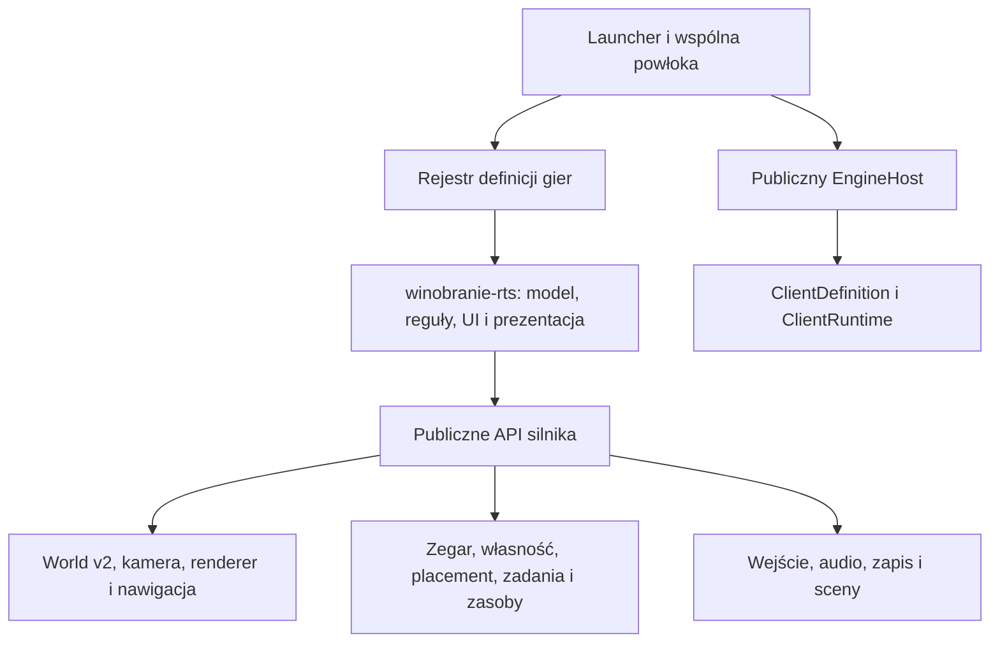

# Winobranie RTS: Trzy sezony — plan wdrożenia W0

**Data:** 2026-11-14. **Zakres wykonany:** inwentaryzacja, decyzje architektoniczne,
kontrakty projektowe, rachunek wstępnego balansu i plan testów. Interfejsy oraz
liczby poniżej są projektem do wdrożenia w W1–W4, nie deklaracją istniejących usług.
W0 nie dodaje gry do katalogu ani nie wydaje nowego ZIP-a.

Wymagania produktu: [WINOBRANIE-RTS.md](WINOBRANIE-RTS.md).
Kolejność i granice prac: [ROADMAP.md](ROADMAP.md).
Wyniki sprawdzenia bazy: [W0-REPORT.md](W0-REPORT.md).

## 1. Baza kodu i zależności PR

Sprawdzono wszystkie widoczne PR #1–#12 i zdalne gałęzie. Nie ma nowszego PR
z implementacją niż #12. Baza techniczna to `feature/p3-soil-adventure`, commit
`3385c6c712de186f4caf6ce01fcdbb6756055694`, z zakończonym sukcesem
[CI 43519491435](https://github.com/ankelmarek/PixelForge/actions/runs/43519491435).
Zawiera rdzeń P0/P1, Dżdżownicę 0.8.0, Atlas oraz instalator 1.2.0.
To potwierdzenie techniczne, nie deklaracja odbioru grywalności Dżdżownicy ani
zgody na scalenie wcześniejszych PR.

`main` na `cdbe163` zawiera nowe wymagania, ale nadal nie ma runtime. Gałąź
`feature/p3-winobranie-rts` powstała z #12. Do niej włączono wyłącznie pięć
zmienionych/dodanych dokumentów z nowszego `main`. Konflikt roadmap rozstrzygnięto
na rzecz wersji 0.3; pełny rejestr wykonanego kodu zachowuje
[osobne archiwum 0.2](ROADMAP-ARCHIVE-0.2-RUNTIME.md). Nie scalano PR do `main`.
PR W0 do `main` dziedziczy wcześniejszy stos kodu; różnicę samego W0 należy
porównywać z `3385c6c7`, a nie uznawać całego stosu za nową implementację RTS.

PR #4 (`96b9e730`) sprawdzono jako materiał historyczny: jego
`SimulationDefinition`, prostą recepturę, rezerwowanie źródła i transport.
Te wspólne mechanizmy już są w bazie. Nie importujemy jego mapy, katalogu gry,
grafik ani ograniczonej pętli produkcji soku jako nowego produktu.

## 2. Co jest dostępne, a czego brakuje

| Obszar i odczytany kod                                         | Stan w bazie                                                                                  | Decyzja dla RTS                                                                                         |
| -------------------------------------------------------------- | --------------------------------------------------------------------------------------------- | ------------------------------------------------------------------------------------------------------- |
| `engine/core/EngineHost.ts`, `api/client.ts`, `scenes/flow.ts` | Zaufany klient, async runtime, preload, pełne okno, pauza, błędy, cleanup                     | Użyć `ClientDefinition`; nie tworzyć drugiej instancji hosta ani kopiować scen                          |
| `world/sectors.ts`, `world/renderer.ts`, `world/validation.ts` | World v2/RLE, LRU, 4 pobrania, maks. 2 nowe tekstury/klatkę                                   | Zachować loader i renderer; udostępnić w publicznym API po zawężeniu typów                              |
| `simulation/types.ts`                                          | `WorldLevel` wymaga również statycznych aktorów, węzłów i celu symulatora                     | Wydzielić zgodny strukturalnie `TerrainWorld`; bez fikcyjnego magazynu/celu w RTS                       |
| `simulation/navigation.ts`, `world/navigation.ts`              | Statyczny indeks prostokątów i komponentów, pieszy oraz pojazd 3×3; ograniczone lokalne A*    | Potrzebna wersjonowana, lokalna invalidacja obu indeksów i tras                                         |
| `world/mutable-grid.ts`, `world/mutable-renderer.ts`           | Zmiany komórek i rewizje tekstur, używane przez Dżdżownicę                                    | Wzorzec nakładki dróg; zmiana tekstury **nie aktualizuje** nawigacji P1                                 |
| `simulation/model.ts`                                          | Krok 50 ms, zbiór, transport, rezerwacja całego źródła, jedna receptura, stałe listy obiektów | Wyodrębniać małe usługi z testami; bez kopiowania całego modelu i bez jego użycia jako gotowej ekonomii |
| `simulation/validation.ts`                                     | 32 aktorów, 256 węzłów/dróg/blokerów                                                          | Zachować stare limity; osobny budżet RTS i pomiary przed podnoszeniem                                   |
| `systems/versioned-save.ts`, `systems/storage.ts`              | Walidacja, oddzielny klucz klienta, brak kasowania starego zapisu przy błędzie                | Nowy gameId, walidacja całej transakcji i jawne migracje                                                |
| `simulation/pointer.ts`, `simulation/camera.ts`                | Klik/pan/zoom, kotwica kursora, stabilny obraz przy 0.5×                                      | Oddzielić kamerę od rozpoznawania gestów; dodać narzędzia budowy i zaznaczania                          |
| `app/game.ts`, `api/types.ts`                                  | HUD, symbole, mierniki, minimapa, komendy tylko focus/zoom/interact                           | Potrzebny opcjonalny panel klienta i komendy strategiczne; brak warunków po gameId                      |
| `systems/audio.ts`                                             | Pięć syntezowanych SFX, sekwencer, master mute/pauza                                          | W1 korzysta z obecnych sygnałów; W4 doda banki dźwięków, magistrale, pętle i limit głosów               |
| `tools/release.py`, `admin-updater/`                           | Full ZIP v1, engineSchemaVersion 2, podgląd/install/rollback                                  | Zachować kontrakt i narzędzie PHP; nowa gra jest częścią całej statycznej aplikacji                     |

Nie ma obecnie usług własności, budowania, pieniędzy, pogody, sieci wody,
zmiennego wieku upraw, identyfikowanych partii ani kampanii trzech lat.
Istniejąca nawigacja wyszukuje na grafie komponentów, potem lokalnym A*;
nie należy opisywać jej jako globalnego optymalnego A*.

## 3. Granice architektury



Host wywołuje zarejestrowany kontrakt, nie importuje klienta. Brak zależności
`engine -> games/app`. Logika bez DOM/Phasera ma osobny publiczny moduł eksportu,
żeby testy modelu nie ładowały renderera. Stare publiczne eksporty pozostają zgodne.

Planowana organizacja klienta:

```text
src/games/winobranie-rts/
  index.ts                 # ClientDefinition, lazy import runtime
  runtime.ts, view.ts, ui.ts
  model.ts, state.ts, validation.ts, commands.ts
  agronomy.ts, frost.ts, production.ts, economy.ts, campaign.ts
  data/                    # cultivars, costs, recipes, scenarios, audio
public/assets/games/winobranie-rts/
  world-v1.json, parcels-v1.json, sectors/, images/, audio/, LICENSE.md
```

W silniku powstaną tylko małe mechanizmy bez nazw winorośli i receptur wina:

| Usługa projektowana         | Kontrakt i odpowiedzialność                                            | Pierwszy etap            |
| --------------------------- | ---------------------------------------------------------------------- | ------------------------ |
| `ScenarioClock`             | tick, krok, tempo 1/2/4, kolejność zdarzeń; klient dostarcza kalendarz | W1                       |
| `LandOwnershipService`      | granice parcel, właściciel, sprawdzenie całego footprintu, rewizja     | W1                       |
| `PlacementService`          | preview/rotate/cancel/commit, kolizje, dostępy, transakcja topologii   | W1                       |
| `DynamicNavigation`         | klasy ruchu, invalidacja regionów, wersjonowane ścieżki, budżet pracy  | W1                       |
| `JobQueueService`           | przydział, priorytet, fazy, rezerwacja ilości i miejsc, anulowanie     | W1                       |
| `ResourceProcessingService` | transfer, pojemność, wsad, receptura, wyjście i pochodzenie partii     | W1; pełny łańcuch W3     |
| `EconomyService`            | kwoty całkowite, koszt, rezerwacja, ledger, obciążenia okresowe        | W1; dług i inwestycje W3 |
| `ClimateEventService`       | deterministyczna oś zdarzeń i stref, próbka pogody/niepewna prognoza   | W2                       |

W1 nie tworzy pustych klas W2/W3. Wspólne serwisy dostają dane i zamknięte
komendy; polityka szkody pąków, ceny odmian, skład wina i reguły wygranej są
w kliencie. Nie powstaje ECS ani interpreter skryptów z JSON.

## 4. Jednostki, dokumenty wejściowe i stan

Świat: 8192² px = 512² komórek po 16 px. Sektor: 32² komórek = 512² px;
katalog ma 256 sektorów. Symulacja przechowuje pozycję w jednostkach komórek,
renderowanie przelicza ją przez `tileSize`. Granice/footprinty mają całkowite
komórki; środek przemieszczającej się jednostki może mieć część ułamkową.
Własność i kolizja obowiązują również w sektorach bez pobranej grafiki.

Projekt manifestu klienta (nie jest obecnym formatem loadera):

```ts
interface RtsManifest {
  schemaVersion: 1;
  id: 'winobranie-rts';
  contentRevision: string;
  world: TerrainWorld; // istniejący format terenu v2, bez danych starego symulatora
  parcels: ParcelDefinition[];
  catalogs: {
    cultivars: string;
    costs: string;
    recipes: string;
    scenarios: string;
  };
  budgets: {
    actors: number;
    rows: number;
    buildings: number;
    jobs: number;
    lots: number;
  };
}
interface ParcelDefinition {
  id: string;
  cells: { x: number; y: number; width: number; height: number }[];
  attributes: {
    sunlight: number;
    elevation: number;
    slope: number;
    soil: string;
    moisture: number;
    coldOffsetC: number;
  };
  access: { roadPort: string; waterSource?: string };
  initialOwner: 'player' | 'market' | 'public';
  priceMinor: number;
}
```

Parcela może składać się z kilku prostokątów, ale jej komórki nie nakładają się
na inne parcele. Publiczne drogi/woda nie są automatycznie gruntem do budowy.
Kupno obejmuje całą parcelę; musi istnieć połączenie z własnym terenem lub
publicznym dojazdem. Atrybuty stref klimatu można rozbić na mniejsze pola niż parcela.

Każdy JSON jest `unknown` aż do walidacji: zgodna wersja, rozmiar dokumentu,
unikalne ID, skończone zakresy, kompletne odwołania, pokrycie sektorów, katalogi
i budżety. Dozwolone tylko lokalne względne ścieżki assetów. Nieznana receptura,
komenda lub odmiana jest błędem; dane nigdy nie dostarczają funkcji.

Stan kanoniczny klienta:

| Część             | Wymagane dane trwałe                                                                                   |
| ----------------- | ------------------------------------------------------------------------------------------------------ |
| Tożsamość         | saveRevision, contentRevision, scenarioId, seed, stan strumieni RNG, następne ID                       |
| Zegar             | tick, reszta kroku, szybkość, dzień/rok wynikające z tick, wynik kampanii                              |
| Ziemia i obiekty  | właściciele, rzędy, drogi, budynki/footprinty, porty, rewizje zmienionych regionów                     |
| Uprawy            | odmiana, plantingYear, liczba żywych krzewów, faza, ciepło, wilgoć, zdrowie, pąki, plon pozostały      |
| Jednostki i praca | pozycja, rola, pojazd/pojemność, ładunek, kolejka, faza, cel, zarezerwowane ilości i miejsca           |
| Produkcja         | magazyny, partie, pochodzenie, zajęte wsady, postęp, zarezerwowana pojemność wyjścia                   |
| Pogoda/woda       | aktywne zdarzenia, zbiorniki, sieć, pompy, tryby zraszaczy, oblodzenie, dawka szkody i czas odmarzania |
| Finanse           | gotówka, dług, zaległości, harmonogram, ledger/totale, pozostałe ułamki naliczanych opłat              |
| Wynik/widok       | sprzedane ilości, ważona jakość, straty, kamera, filtry, zaznaczenie istniejących ID                   |

Kwoty: całkowite setne umownej monety. Ilości: gramy, mililitry i sztuki;
jednostka jest częścią typu zasobu. Jakość i zdrowie: całkowite 0–10000.
Wszystkie liczniki mają limity i używają bezpiecznych liczb całkowitych.
Ułamki zużycia gromadzi akumulator, a nie zaokrąglenie do zera przy każdym ticku.
Zegara gry nie wyznacza `Date.now()`.

Rząd jest agregatem podzielonym najwyżej na odcinki o wspólnym wieku, odmianie
i mikroklimacie (docelowo do 8). Lista krzewów do rysowania wynika z geometrii.
Nie ma tysięcy obiektów Phasera lub oddzielnego AI każdego krzewu poza ekranem.

## 5. Budowanie i transakcje topologii

Startowa parcela ma proponowane 1536² px w centrum, gotowy magazyn i dojazd,
48 dorosłych krzewów w trzech małych grupach, dwóch pracowników oraz traktor.
Dwa domki są **dwoma uprawnieniami do postawienia**, nie przypisanymi miejscami.
Nie można sprzedać niewykorzystanego uprawnienia i następnie postawić domu za darmo.

Rzędy: przeciągnięcie początku/końca, punkty kotwiczone w siatce 16 px, kierunek
wynika z obu punktów (nie tylko cztery kierunki). Sadzonki co 32 px, sugerowany
odstęp osi rzędów co najmniej 64 px. Walidacja rasteryzowanego całego odcinka
z szerokością podpór; nie wystarczy sprawdzenie dwóch końców. Droga ma domyślnie
48 px szerokości. Obrót domku co 90° obraca także porty i plac manewrowy.
R oznacza wyłącznie opcjonalny skrót; ikona obrotu wystarcza do całej gry.

Projekt kontraktu:

```ts
type PlacementResult =
  | { status: 'checking'; planId: string }
  | {
      status: 'invalid';
      reason:
        | 'ownership'
        | 'slope'
        | 'collision'
        | 'access'
        | 'water'
        | 'funds'
        | 'limit';
    }
  | {
      status: 'valid';
      planId: string;
      worldRevision: number;
      costMinor: number;
    };
// preview(intent) -> PlacementResult; rotate(planId); cancel(planId);
// commit(planId, expectedRevision) -> { applied: boolean; newRevision?: number };
```

Preview nie zmienia pieniędzy, świata ani RNG. Czerwony obrys pokazuje konflikt,
zielony poprawność, neutralne pulsowanie sprawdzanie dojazdu. Potwierdzenie
przechodzi w kolejkę do granicy ticka i ponownie sprawdza:

1. Pełną własność, nachylenie, brak kolizji, budżet i aktualność planu.
2. Dojście pracownika i przejazd pojazdu do portu w **proponowanym** układzie.
3. Zachowanie dostępu do istniejących czynnych wejść, magazynu i wyjazdu;
   brak uwięzienia jednostek oraz miejsca pod nimi lub w rezerwowanym doku.
4. Dostęp do wody tylko dla urządzeń/receptur, które go wymagają.
5. Jednoczesne zatwierdzenie wydatku/uprawnienia, obiektu, rewizji i zlecenia
   budowy. Błąd anuluje całość, bez połowy obiektu albo zabranej gotówki.

Przeniesienie domku jest jedną transakcją starego i nowego miejsca. Dozwolone,
gdy nie ma aktywnego procesu, wsadu, ładunku ani rezerwacji doku. Zapas wcześniej
trafia zwykłym transportem do magazynu. Rezerwuje się koszt i nowe miejsce;
stary budynek działa jako obiekt do ukończenia przeprowadzki, ale nie przyjmuje
nowych prac. Po ukończeniu następuje atomowa podmiana topologii. Gdy cel przestaje
być dostępny, przeprowadzka czeka lub jest anulowana bez utraty budynku.
Usunięcie rzędu daje najwyżej 10% ceny sadzonek; preview anulowany przed commit
nie ma kosztu. Obiekt po commit nie ma darmowego „undo”.

### Nawigacja dynamiczna — najpierw kontrakt, potem budowanie

- Wydzielić indeks statycznego terenu oraz nakładkę dróg/blokerów. Nie mutować
  `WorldLevel` za plecami obecnego `Navigator`, który zapamiętuje prostokąty.
- Dla każdego regionu i profilu ruchu trzymać lokalne komponenty, przejścia
  i rewizję. ID komponentu zawiera region/profil/rewizję, aby stare połączenie
  nie wskazało przypadkiem nowego komponentu z tym samym numerem.
- Zmiana oznacza brudne regiony przecięte footprintem powiększonym o zasięg
  kolizji (dla pojazdu minimum jedna komórka) oraz sąsiadów przy granicy.
  Odbudować tylko ich komponenty i obustronne portale; także po dodaniu drogi.
- Walidacja placement używa tymczasowego indeksu zmienionych regionów. Dojazd
  sprawdza graf, a nie pełne A* 512². Kontrola istniejących portów dotyczy
  spójności z publicznym wyjazdem/hubem także po przecięciu drogi poza kamerą.
- W1 zachowuje profile pieszy/pojazd 3×3. Zakręty wymagają sprawdzenia całego
  footprintu. W W3 większy traktor dostaje osobny profil i ograniczenie skrętu;
  samo zwiększenie prędkości sprite'a nie spełnia tego wymagania.
- Trasa zapisuje cel oraz rewizje przecinanych regionów. Zmiana poza nią nie
  powoduje przeliczenia. Przed wejściem w zmieniony region jednostka zatrzymuje
  się bez utraty ładunku, potem otrzymuje nową trasę albo stan blokady.
- Odnowienie topologii budzi zablokowane zadanie. Nie kasować go tak jak przy
  `route() == null` w starym prostym symulatorze. `pending`, `unreachable`
  i `budget` to różne wyniki; zabraknięcie budżetu nie oznacza braku drogi.
- Startowy indeks budować partiami w ekranie ładowania. Limit pracy na jedną
  klatkę: proponowane 4 regiony lub 4096 lokalnych rozwinięć; algorytm oddaje
  sterowanie i kontynuuje. Preview jest tylko widokiem. Po przyjęciu komendy
  commit/replan kolejność i budżet obliczeniowy są przypisane do ticka/ID;
  dzielenie pracy na klatki nie może zmienić ticka zastosowania wyniku.
  Gdy praca danego ticka nie jest gotowa, model czeka z następnym tickiem,
  a renderer/UI nadal działają. Nie stosować wyników według kolejności
  zakończenia asynchronicznych callbacków. T1 obejmuje także ten przypadek.
- Zachować maksymalnie 8192 rozwinięcia grafu / 65536 lokalnych na zapytanie,
  bez awaryjnego pełnego A*. Po pomiarach można obniżyć budżet, nie usuwać go.
- Jednostki ruchome nie przebudowują grafu w każdej klatce. Rezerwują doki
  i krótkie odcinki pasa; kolejność według priorytetu/ID, czekanie i zatoki
  ograniczają deadlock. Po limicie oczekiwania ponowna trasa lub ikona blokady,
  nigdy teleport. Zmienna liczba jednostek wymaga testów mijania.

## 6. Zegar, komendy i powtarzalność

Krok symulacji: **50 ms**. Dzień: 400 ticków = 20 s przy x1. Rok: 30 dni
(8 wiosny, 12 lata, 10 jesieni) = 600 s. Trzy lata = 1800 s bez pauz.
Cel 30–35 minut uwzględnia zarządzanie/pauzy, lecz wymaga ludzkiego pomiaru.
W1 ma osobny scenariusz `slice` z 240 tickami/dzień, jednym rokiem (360 s),
uproszczonym dojrzewaniem i stałą łagodną pogodą. Nie jest pełną kampanią W3.

Przy x4 wykonuje się cztery razy więcej tych samych ticków, bez zwiększania
`delta` reguł. Budżet pracy na klatkę pozostawia nadmiar w kolejce i najwyżej
spowalnia zegar względem ściany; nie pomija pogody, płac lub zbioru. Pauza
zatrzymuje wszystkie skutki, a ukryta karta nie nadrabia czasu po powrocie.

Stała kolejność ticka: komendy → gotowe transakcje topologii → pogoda/sieć wody
→ agronomia/szkody → przydział i ruch → praca/transfer → przetwarzanie/sprzedaż
→ płace/utrzymanie → podsumowanie dnia i warunki końca → snapshot.
Komendy mają rosnący numer i tick wykonania. Powtórzone zatwierdzenie zakupów
nie może ponownie pobrać pieniędzy. Zdarzenia tego samego ticka rozstrzyga ID.

RNG jest deterministyczny i rozdzielony na strumienie pogody, rynku i scenariusza.
Dekoracje używają oddzielnego strumienia bez wpływu na logikę. Prognoza jest
funkcją seed/dzień/horyzont; ponowne otwarcie panelu nie losuje innej prawdy
ani nowej prognozy. W testach porównuje się ten sam seed i komendy przy tych
samych tickach, nie komendy wysłane w tych samych sekundach czasu ściennego.

## 7. Pracownicy, transport i partie

`JobQueueService` operuje na zadaniach z ID, rolą, priorytetem, celami i fazą
`queued/reserved/travel/work/deliver/blocked/done/cancelled`. Klient rejestruje
zaufane wykonanie sadzenia, pielęgnacji, zbioru i obsługi urządzenia. Przydział
uwzględnia dostępność pracownika, drogę i pojemność celu, nie sam dystans w linii.
Praca w winiarni zabiera pracownika z pola; proces pasywny może później zwolnić
operatora zgodnie z recepturą. Dwa domki mogą przetwarzać dowolne odmiany.

Rezerwacje są ilościowe: odcinek rzędu/skrzynka, ilość partii, aktor, zadanie,
dok i pojemność wyjścia. Nie blokują całego rzędu jednym człowiekiem. W jednej
transakcji można przenieść tylko zasób z istniejącego właściciela do nowego.
Ładunek zawsze jest w jednym miejscu: rząd/skrzynka, magazyn, aktor albo wsad
procesu. Anulowanie zadania nie usuwa ładunku. Zwolnienie człowieka i przeniesienie
budynku czekają na bezpieczne oddanie zasobów oraz zwolnienie rezerwacji.

Partia: `{ id, cultivarId, vintage, resourceId, quantity, quality, originIds }`.
Dzielenie tworzy dzieci z sumą ilości równą rodzicowi. Łączenie tylko zgodnych
odmian/roczników/zasobu, z jakością ważoną ilością. Źródłowa jakość nie może się
poprawić przez dowolne dzielenie i zaokrąglanie. Receptura określa zmiany jakości.

Docelowo: grona → moszcz → fermentacja → wino → butelkowanie → sprzedaż.
Przykładowa receptura bilansu: 1000 g gron daje 600 ml moszczu; fermentacja
600 ml daje 570 ml wina i 30 ml jawnej straty technologicznej; butelka zużywa
750 ml. Reszta płynu zostaje w partii. Bilans sprawdza każdą konwersję w jej
jednostkach, nie sumuje gramów z mililitrami ani wartości rynkowej produktów.
Wsad jest zdejmowany raz przy starcie, a miejsce wyniku rezerwowane do końca.
Brak miejsca w magazynie blokuje pracę, nie usuwa produktu.

W1 kończy łańcuch na sprzedaży **moszczu**, zgodnie z zakresem „tłoczenie → pierwsza
sprzedaż”. Wino i 500 butelek należą do W3. W1 nie pokazuje fikcyjnego przycisku
fermentacji, obietnicy pełnej kampanii ani gotowych butelek bez procesu.

## 8. Agronomia, pogoda i ciągła ochrona (W2)

Katalog sześciu odmian jest jeden i walidowany. W1 udostępnia Solaris,
Johanniter i Regent; W2 dodaje Muscaris, Rondo oraz Cabernet Cortis. Parametry:
koszt, kolor, próg ruszenia pąków, suma ciepła, plon, podatność na chorobę,
stres suszy, krzywe cukru/kwasowości i jakości oraz ceny. Są to parametry gry,
nie naukowy ranking odporności odmian.

Wiek nasadzenia w roku sadzenia daje proponowane 10% plonu, w kolejnym 55%,
od trzeciego 100%. Dochodzą faza, dostępne ciepło, zdrowe pąki i wilgotność.
Zbiór zdejmuje tylko pozostały plon bieżącego rocznika. Nie odradza owoców
przez ponowne zlecenie. Siewka nie staje się dorosła od powrotu kamery.
Różnice mikroklimatu rozliczane na odcinkach rzędów; jedna choroba i jedna
susza wystarczą, z widocznym ostrzeżeniem i dostępnym działaniem ratunkowym.

Pogoda ma przebieg temperatury wewnątrz dnia, deszcz, wilgotność, słońce i wiatr.
`ClimateEventService` dostarcza próbkę i strefę, a klient oblicza stan pąków.
Prognoza na 1–3 dni pokazuje zakres i pewność; zawczasu sygnalizuje ryzyko,
nie losuje katastrofy dopiero przy jej wyświetleniu. Epizod może przekraczać
granicę dnia, regionu i zapisu.

Sieć: źródło/zbiornik → połączone rury → pompa → zraszacze. Po przebudowie
lokalnie odświeżany graf wody, osobny od grafu ruchu. Rozdział przepływu jest
deterministyczny, z priorytetami stref. Wymagana ilość zależy od pokrytej
powierzchni, temperatury i wiatru. Faktyczny strumień ograniczają zbiornik,
wydajność pompy, energia i drożność połączeń. Nakładanie zraszaczy nie mnoży
ochrony ponad maksimum, ale zużywa rzeczywistą wodę.

Stan ochrony: `off → spraying → icing → thawing → safe`, z przejściem do
`interrupted` po zbyt małym przepływie w czasie oblodzenia. Automat uruchamia
się od lokalnego progu, ręczne przełączanie pozostaje dostępne. Ochronę liczy
**bieżący przepływ w każdym ticku**, nie flaga „raz włączono”. Wyłączenie,
brak wody/energii albo przecięta rura są tym samym brakiem ciągłości.

Model szkód jest dawką: niedobór temperatury względem fazy pąków × czas ×
mikroklimat/wiatr × brak skutecznej ochrony. Uszkodzenie narasta i ogranicza
przyszły plon. Oblodzenie przy przerwanym strumieniu zwiększa dawkę (wstępnie
mnożnik 1.5); ponowne uruchomienie nie cofa szkód. Parametry wymagają testów,
nie stanowią porady agronomicznej. Przy pogodzie przekraczającej możliwości
instalacji sama obecność zraszacza nie gwarantuje ochrony.

Bezpieczny koniec wymaga ustąpienia mrozu **i stopienia lodu**: proponowany
próg +1°C utrzymany przez co najmniej 10 s symulacji oraz oblodzenie równe zero.
Woda i energia zużywane także podczas odmarzania. Alarm wygasa dopiero wtedy.
Próg można zbalansować w konfiguracji; nie wolno zastąpić go końcem animacji.
Wstępny fixture: zbiornik 1500 L, pompa 2 L/s, osiem zraszaczy po 0.2 L/s,
epizod 60 s plus odmarzanie. Przy takim przykładzie 20 L nie wystarcza,
a 1500 L wystarcza z zapasem. Inne warunki mogą zmienić wymagany strumień.

Testy na tym samym seedzie, czasie i stanie upraw: bez ochrony, pełny ciągły
strumień, mały zbiornik, awaria pompy w połowie, zbyt wczesne wyłączenie,
jednosekundowe kliknięcie, przecięta rura, ograniczenie wydajności wielu zraszaczy.
Porównać straty, zużytą wodę/energię i plon; poprawne zraszanie ma niższą szkodę,
krótkie kliknięcie nie może zbliżać się do wyniku pełnej ochrony. Powtórzyć
x1/x4, poza ekranem i z zapisem w środku mrozu/odmarzania.

## 9. Ekonomia, wartości wstępne i zakończenie

Wszystkie ceny są danymi, a nie warunkami w silniku. Start: 30 000 monet,
dwa uprawnienia do domków, dwaj ludzie, jeden traktorek, magazyn i dojrzałe
nasadzenia. Poniższe wartości są propozycją do testów, nie wynikiem playtestu.

| Parametr                                     |                                            Propozycja |
| -------------------------------------------- | ----------------------------------------------------: |
| Sadzonka zależnie od odmiany                 |                       24–45 monet; fixture średnio 30 |
| Komórka drogi 16×16 px                       |  4 monety; droga dla traktora potrzebuje szerokości 3 |
| Dodatkowa parcela                            |                   4000–9000, zależnie od cech/dojazdu |
| Trzeci mały domek / ulepszenie prasy         |                                           8000 / 3500 |
| Traktor mały / mocny / z dużą przyczepą      |                                    4500 / 7500 / 9500 |
| Zatrudnienie stałego / sezonowego pracownika |                                             250 / 100 |
| Płaca za dzień gry, stały / sezonowy         |                                                8 / 12 |
| Utrzymanie małego traktora / domku za dzień  |                                                 4 / 3 |
| Zestaw zbiornik, pompa, rury i 8 zraszaczy   |               około 5000, z osobnymi cenami elementów |
| Zakup wody / energia                         |           1 moneta/L / 0.1 monety za umowną jednostkę |
| Mała pożyczka                                | do 5000, 10% łącznego kosztu, termin w kalendarzu gry |
| Cena butelki o jakości 65 w fixture          |        45 monet; jakość/odmiana/rynek modyfikują cenę |

Ledger rozdziela przychody, koszty, kapitał pożyczki, odsetki i zaległości.
Sprzedaż usuwa konkretną partię dokładnie raz; pożyczka nie jest przychodem
ani wynikiem produkcji. Płace i utrzymanie są naliczane według ticków, również
poza kamerą i przy x4. Brak gotówki zatrzymuje zakupy. Niezapłacone obciążenie
tworzy zaległość oraz ostrzeżenie, nie kasuje ludzi/maszyn z ładunkami.

Przed porażką: możliwość sprzedaży gron/partii, sprzedaży zbędnego sprzętu
po rozliczeniu ładunku, redukcji zatrudnienia i ograniczonej pożyczki. Zamówiona
woda ma koszt i czas dostawy do osiągalnego punktu; nie pojawia się od kliknięcia
w każdym odległym zbiorniku. Wczesna porażka wymaga braku środków/zdolności
ratunku po okresie ostrzeżenia (proponowane trzy dni gry). Nie wywołuje jej
samo ujemne saldo prognozy ani jednorazowa utrata plonu. Gdy dochód z dojrzewającej
uprawy lub istniejącego zapasu nadal jest osiągalny, gra pozostaje w kryzysie,+a nie arbitralnie ogłasza trwałą niewypłacalność.

### Rachunek kontrolny, nie symulacja ukończenia

Fixture pojemności: 48 dorosłych krzewów, 128 nowych posadzonych w pierwszej
wiośnie, potencjał 2 kg/krzew/rok, współczynniki wieku 0.10/0.55/1.00, 600 ml
moszczu/kg, uzysk fermentacji 95%, 750 ml/butelkę, bez szkód i opóźnień:

| Rok |    Grona |      Wino | Górny limit pełnych butelek w roku |
| --- | -------: | --------: | ---------------------------------: |
| 1   | 121.6 kg |  69.312 L |                                 92 |
| 2   | 236.8 kg | 134.976 L |                                179 |
| 3   |   352 kg | 200.640 L |                                267 |

Razem najwyżej 538 przy osobnym zaokrągleniu roczników. Podział na odmiany
i partie może zmniejszyć tę liczbę; reszty płynów pozostają w zapasie.
Bez nowych nasadzeń limit zbiorczy to około 218 butelek. Oznacza to, że sadzenie
ma znaczenie, a próg 500 nie powinien być uznany za zbalansowany: margines na
straty jest mały. W3 musi sprawdzić większe nasadzenia, jakość, transport,
przepustowość i sens ochrony, zamiast ustawić korzystny seed pod jeden wynik.

Przykładowe wydatki: 128 sadzonek po 30 = 3840; 160 komórek dróg = 640;
ochrona 5000; traktor 4500; trzeci domek 8000; parcela 6000; zatrudnienie 250.
Suma 28 230 pozostawia 1770 z 30 000 **przed** płacami, energią i wodą.
Kupno wszystkiego od razu tworzy ryzyko płynności; plan nie zakłada, że wszystkie
te inwestycje są konieczne. W1 ogranicza się do dwóch domków z uprawnień.

W3 porównuje trzy polityki dla tych samych seedów: większy plon i transport,
mniejsze partie premium/ulepszenia, zróżnicowane odmiany i ochrona. Każda ma
wygrywać na więcej niż jednym seedzie. Testowy agent wysyła te same komendy
co gracz; nie dopisuje gotówki, nie teleportuje ładunków i nie zna tajnej pogody.

Po ostatnim ticku jesieni roku 3: najpierw rozliczyć transakcje tego ticka,
następnie raz zamknąć kampanię. Stan wyniku jest trwały, zegar/produkcja stają.
Wygrana wstępnie wymaga łącznie: ≥500 sprzedanych butelek, jakości ważonej
liczbą butelek ≥65, wartości netto ≥0, co najmniej dwóch szczepów, które w roku
3 rzeczywiście dały plon. Cztery warunki można pokazać w trzech grupach HUD:
sprzedaż, jakość, trwałość gospodarstwa. Częściowy sukces: czynna winnica bez
kompletu warunków. Wcześniejsza trwała niewypłacalność lub brak możliwości
odbudowy po utracie wszystkich krzewów to porażka.

Wartość netto = gotówka + zachowawcza wartość likwidacyjna własnych aktywów
i zapasu − dług − zaległości. Nie używać zakupu/sprzedaży między własnymi
magazynami do poprawiania wyniku. Nieukończone procesy nie dają darmowych butelek
w finale; zasób we wsadzie może mieć wyłącznie określoną wartość likwidacyjną.

## 10. Sterowanie, prezentacja i audio

W1: klik wybiera, aktywne narzędzie przejmuje przeciągnięcie. Bez narzędzia
przeciągnięcie pustego terenu przesuwa kamerę; ikona zaznaczania przełącza na
prostokąt wyboru. Próg gestu wyrażony w pikselach CSS, z obsługą wyjścia kursora,
anulowania i utraty fokusu. Mysz nie przesuwa świata podczas malowania rzędu.
PPM oraz widoczna ikona anulują. Zoom kotwiczony pod kursorem, minimapa i alert
pozwalają skoczyć do obiektu. Każda niezbędna akcja ma przycisk.

W `ClientDefinition` zaprojektować opcjonalne `createControls(context)`, zwracające
`destroy()`. `context` daje korzeń panelu, snapshot i wysłanie komendy. Klient
buduje własne panele przez DOM, wspólna aplikacja zachowuje start, pauzę, mute,
wynik i cleanup. Strategia nie musi wyświetlać kierunkowego krzyżaka Dżdżownicy.
Komenda silnika otrzyma generyczną kopertę `client-action` (action + dane JSON);
klient waliduje ją do zamkniętej, typowanej unii `RtsCommand`. Nie ma `eval`,
instrukcji z JSON ani `if (gameId === 'winobranie-rts')` w host/aplikacji.

Snapshot strategiczny: czas/rok/tempo, pogoda, finanse, liczba dostępnych ludzi
i pojazdów, produkcja, cele, wybór/narzędzie oraz alerty z pozycją. To dane do
prezentacji, nie mutowalny stan modelu. Liczby, ceny i nazwy odmian są dozwolone.
Po decyzji użytkownika z 2026-11-14 także krótki komunikat „Co teraz?” jest
projekcją bieżącego stanu klienta. Panel jest zwijany, wskazuje obiekt kamerą,
nie zatrzymuje gry ani nie wykonuje rozkazów. Modalne samouczki pozostają poza zakresem.
W1 pokaże tylko działające narzędzia, bez dekoracyjnych przycisków W2/W3.

Nie odkładać całej jakości do W4: już W1 ma czytelny teren, sylwetki ludzi,
traktor, ładunki, rzędy, animację pracy, zmianę stanu i SFX. W4 dopracowuje
sezony, odmiany, dekoracje i cały miks. Wszystkie assety mają pochodzenie/licencję.
Sektory terenu są statyczne, drogi/rzędy to osobna unieważniana nakładka,
jednostki i pracujące urządzenia są sprite'ami z cullingiem i sortowaniem po Y.
Zachować `pixelAlignedScroll`, NEAREST i test obrazu przy zoomie 0.5.

W4 rozszerzy wspólne audio o deklarowany bank SFX, osobne music/effects/ambient,
regulację i mute oraz pętle z pozycją. Proponowany limit 16 głosów: rezerwa
na alarmy, ograniczenie identycznych odgłosów i tłumienie według kamery.
Praca poza kamerą trwa logicznie bez 30 równoczesnych dźwięków. Pauza/destroy
zatrzymują wszystkie głosy i timery. Odtwarzanie dopiero po geście użytkownika.

Desktop jest odbiorem W1. Istniejące testy mobilne Atlasu/Dżdżownicy nadal muszą
przechodzić. Dostosowanie kompletnej strategii do dotyku jest późniejsze;
nie deklarować gotowej wersji telefonu po samym responsywnym canvasie.

## 11. Zapis, migracje i paczki

ID: **`winobranie-rts`**, pierwszy klucz: `pixelforge:client:v1:winobranie-rts`.
Nie czytać ani nie migrować starego `winobranie`; nie nadpisywać Dżdżownicy v1/v3
ani Atlasu v2. Zapis obejmuje pełny stan z sekcji 4; nie zapisuje tekstur, LRU,
indeksów komponentów, ścieżek odrzuconych ani stanu podglądu budowy.
Zapis na granicy ticka po transakcji, istotnej zmianie, pauzie, wyjściu i okresowo
(wstępnie co 10 s symulacji, z ograniczeniem częstości czasu rzeczywistego).

Odczyt: parse → limity/wersja → walidacja referencji i bilansu → zbudowanie
topologii → sprawdzenie portów/pozycji → odtworzenie zadań → publikacja całego
modelu. Żadnej częściowej podmiany aktywnego stanu. Trasy można odtworzyć z celu,
ale nie wolno zgubić aktualnej pozycji, fazy pracy, ładunku i rezerwacji.
Zmiany budowy i RNG pozostają identyczne po wznowieniu.

Następna niezgodna wersja ma nowy klucz; migracja to jawna funkcja starego
zwalidowanego DTO do nowego. Odczytuje stary klucz bez zapisu, waliduje nowy
i dopiero publikuje pod nowym. Stary rekord zostaje na potrzeby rollbacku.
Jeśli nowy rekord istnieje, ale jest uszkodzony, nie cofać po cichu postępu
do starego. Potrzebny generyczny wynik odczytu `absent/invalid/ready`, zachowujący
obecne `read()` dla istniejących klientów. Brak miejsca/odmowa localStorage:
komunikat techniczny i zachowany ostatni poprawny rekord.

Budżet docelowego zapisu: do 1.5 mln znaków UTF-16 (około 3 MiB), poniżej obecnej
granicy odczytu 4 mln znaków i z kontrolą rzeczywistego quota błędu. Dziennik
kompaktowany do sum okresowych + ograniczonego ogona, bez utraty bilansu i ID
ostatnich transakcji. Rewizja świata/katalogu jest częścią zgodności; nowsze
nieznane dane są odrzucane, a nie interpretowane jako bieżący format.

W0 zachowuje release **0.8.0** i wszystkie archiwa. W1/W4 dostaną nową wersję
całej aplikacji dopiero po buildzie/testach; nigdy nowych bajtów pod starym
numerem. `package:release` pakuje całą aplikację, w tym dotychczasowe gry.
Manifest full v1 / engineSchemaVersion 2 i PHP 1.2.0 mogą zostać zgodne, jeśli
zmiany API są addytywne; nowa wewnętrzna wersja danych gry nie wymaga zmiany
schematu instalatora. To trzeba sprawdzić walidatorem i realnym rollbackiem.
Nie powstaje osobny instalator Winobrania, backend, U3 ani automatyczny deploy.

## 12. Budżety i pomiary przed podniesieniem limitów

| Obszar                   | W1                                                                | Cel W3/W4, dopiero po pomiarze               |
| ------------------------ | ----------------------------------------------------------------- | -------------------------------------------- |
| Aktorzy modelu           | do 32, start 2 ludzi + 1 pojazd                                   | do 64, np. 48 ludzi + 12 pojazdów + rezerwa  |
| Rzędy / budynki          | do 64 / 32                                                        | do 256 / 64, maks. 128 krzewów/rząd          |
| Aktywne zadania / partie | do 256 / 512                                                      | do 1024 / 2048                               |
| Cache sektorów           | 48 danych, widok z marginesem maks. 42 przy obecnym viewport/zoom | bez bezwarunkowego zwiększania               |
| Tekstury terenu          | do 42 MiB dla 42 sektorów 512² RGBA                               | osobno liczyć nakładki i atlasy              |
| Całość tekstur           | proponowany budżet 128 MiB                                        | zmierzyć, nie mylić z samym `textureBytes`   |
| Wydajność                | cel 60 FPS desktop, brak blokad >50 ms od placement               | stress przy x4 i docelowej liczbie jednostek |

Żaden limit nie jest obietnicą osiągniętego FPS. Fixture obciążenia wypełnia
mapę rzędami, pracującymi domkami, jadącymi traktorami i zmianami topologii.
Pomiar: p50/p95 czasu klatki i ticka, budowa indeksów, lokalne rozwinięcia,
liczba dotkniętych regionów, długość kolejki, heap po powrocie kamery, wszystkie
tekstury, liczba sprite'ów. Ruch w odległe sektory nie zwiększa cache bez końca.
Jeśli limit nie przejdzie, poprawić agregację/indeks lub obniżyć cel, nie tylko
zmienić stałą walidatora. Tryb jakości redukuje cząsteczki, nie skutki pogody.

## 13. Kolejność W1 i kryteria jego odbioru

| Przyrost | Zmiana                                                                                | Bramka przed następnym                                                                      |
| -------- | ------------------------------------------------------------------------------------- | ------------------------------------------------------------------------------------------- |
| W1a      | Publiczny TerrainWorld, indeks dynamiczny i testy synthetic; zegar                    | Atlas i Dżdżownica bez regresji; koszt edycji zależy od regionów, nie całej mapy            |
| W1b      | Klient, scenariusz slice, mapa 8192², kamera/minimapa, własność, preview i transakcje | Mysz rysuje drogi/rzędy i ustawia/obraca dwa domki; niedozwolony plan nie pobiera pieniędzy |
| W1c      | Dwóch ludzi, traktor, rezerwacje, doki, rzeczywisty transport i prasa                 | Pełny bilans również po anulowaniu, blokadzie drogi i poza kamerą                           |
| W1d      | Pierwsza sprzedaż moszczu, prosty wynik slice, zapis i finalna oprawa wycinka         | Pełne 5–8 min wejściem gracza, E2E, bad config/asset/save i pomiar wydajności               |

W1 kończy się po roku slice (360 s symulacji). Proponowany prosty sukces:
sprzedaż co najmniej 40 L moszczu i brak zaległości; wynik pokazuje też koszty,
straty oraz zasoby. Źródłem pierwszego dochodu jest dorosła część startowa;
nowe krzewy nie otrzymują natychmiast pełnego plonu. Wybory w wycinku: położenie
domków i drogi, podział dwóch ludzi między pole/budowę/prasę, odmiana i długość
nowego rzędu, kolejność dostaw. Wynik musi zależeć od tych wyborów.

Odbiór: cała trasa samą myszą, budowanie przez gracza, minimum jedna poprawna
zmiana trasy po postawieniu/usunięciu przeszkody, fizyczne przeniesienie skrzynek,
zużycie surowca i wzrost gotówki, wznowienie w połowie zadania. Brak placeholderów
udających pracujące systemy, tekstowych tutoriali i nowych zależności runtime
bez uzasadnienia. Małe commity/przeglądy w obrębie W1; W2 dopiero po odbiorze.

## 14. Macierz testów W1–W4

| ID / etap    | Co sprawdzać                                                                                           | Dowód przejścia                                                                   |
| ------------ | ------------------------------------------------------------------------------------------------------ | --------------------------------------------------------------------------------- |
| C1 / W1      | Manifest, katalogi, ID, zakresy, limity, brak skryptów i zewnętrznych ścieżek                          | Poprawna konfiguracja przyjęta, mutacje odrzucone z diagnostyką                   |
| C2 / W1      | Własność całego odcinka, obrót portów, stok, overlap, brak środków, stary preview, podwójny commit     | Nieudane operacje pozostawiają identyczny stan i pieniądze                        |
| N1 / W1      | Budowa/usunięcie drogi na granicy sektora i w innym sektorze, rozłączone komponenty, 3×3               | Trasa poprawna w nowej topologii, reszta grafu zachowuje rewizje                  |
| N2 / W1      | Odcięcie wejścia, jednostka w footprint, długie kolejki, mijanie, limit wyszukiwania                   | Odrzucenie złej budowy lub jawne czekanie/blokada, bez teleportów                 |
| J1 / W1      | Dwóch ludzi przy jednym rzędzie, dwa pojazdy po tę samą skrzynkę, pełny dok/magazyn                    | Brak podwójnej rezerwacji, duplikacji i utraty, możliwość wznowienia              |
| P1 / W1/W3   | Split/merge partii, wsad w toku, pełne wyjście, anulowanie, brak operatora                             | Bilans per receptura; jakość ważona; zero ujemnych ilości                         |
| E1 / W1/W3   | Zakup/pożyczka/sprzedaż, granica dnia, opłaty, zaległości, ratunek                                     | Ledger odpowiada stanowi, pożyczka nie podbija sprzedaży, uczciwy czas reakcji    |
| T1 / W1–W3   | Ten sam seed i komendy przy x1/x2/x4 oraz różnych FPS                                                  | Ten sam hash stanu logicznego po równych tickach; zero zmian w pauzie             |
| A1 / W2      | Sześć odmian, wiek, suma ciepła, wilgoć, pąki, zbiór raz/rok                                           | Nowa sadzonka nie ma pełnego plonu; mierzalne różnice odmian i stanowisk          |
| F1 / W2      | Wszystkie warianty zraszania z sekcji 8, poza kamerą i po wznowieniu                                   | Sensowne różnice strat i zgodny bilans wody/energii, brak ochrony jednym clickiem |
| S1 / W1–W3   | Save podczas budowy, transportu, wsadu, mrozu, ostatniego ticka; uszkodzony lub przyszły format; quota | Atomowe odtworzenie/odrzucenie i zachowany ostatni poprawny rekord; izolacja gier |
| U1 / W1      | Cała obsługa myszą, gesture cancel, focus, resize, zoom 0.5, wejście/wyjście                           | Pierwsza sprzedaż i wznowienie przez realny UI; aktualne, zwijane komunikaty      |
| G1 / W3      | 3 lata, 4 warunki wygranej, częściowy sukces, porażka/ratunek, wynik po reload                         | Dokładnie jeden finał, brak darmowego kończenia produkcji, koniec każdej kampanii |
| G2 / W3/W4   | Trzy polityki, zestaw seedów, łagodna i trudna pogoda                                                  | Pełne kampanie od zera bez cheatów; żadna polityka nie wymaga dopasowanego RNG    |
| V1 / W4      | Tekstury/sprite'y/heap/ticki, nawigacja w trakcie budowy, x4, dźwięki/pauza/mute                       | Pomiary z podaną maszyną i profilem; limit głosów i brak narastania zasobów       |
| D1 / wydanie | Full ZIP pod / i /PixelForge/, panel PHP 1.2.0 install/rollback/reinstall                              | Gra oraz save wznawiane, stare zapisy i konto panelu zachowane                    |

Pierwsze testy nawigacji/placement używają neutralnego fixture magazynu i drogi,
nie klienta Winobrania. Test architektury pozostaje obowiązkowy. W W1 istniejące
asercje zakazujące słowa/prefiksu `winobranie` trzeba zawęzić do **dokładnego ID**
starej gry (np. segment ścieżki `games/winobranie/`), dodać `winobranie-rts` do
oczekiwanego katalogu i nadal zabraniać importów `engine -> games`. Nie wyłączać
całego testu ani odblokowywać historycznej gry.

Regresja: lint, typecheck, Vitest/Python/PHP, build i obecne Playwright. W1 dodaje
przeglądarkowy przebieg strategii, brak assetu/sektora, błędny JSON i wadliwy save.
W3 model przechodzi kampanię w testach bez renderera; test UI używa prawdziwych
komend, z osobnym zaznaczeniem przyspieszonego fixture. W4 3–5 nowych graczy:
czas do pierwszej sprzedaży, zrozumienie budowy i alarmu, wynik, czas całego
przejścia (średnia i rozrzut). Bez takiego pomiaru 30–35 minut pozostaje celem.

## 15. Ryzyka i warunki kolejnego kroku

1. **Topologia dynamiczna:** może odcinać wejścia lub unieważniać rezerwacje.
   W1a i N1/N2 muszą przejść przed dodaniem narzędzi użytkownika.
2. **Rozmiar i limity:** duża mapa nie potwierdza wydajności większej liczby AI.
   Agregacja rzędów, kolejki wyszukiwania i pomiar poprzedzają większe limity.
3. **Tempo/ekonomia:** rachunek bez strat nie dowodzi wygranej. W3 wymaga pełnych
   symulacji kilku strategii i kontroli przepustowości, W4 ludzkich playtestów.
4. **Czytelność bez modalnego tutorialu:** preview, ikony, stany blokady i krótkie
   komunikaty wymagają obserwacji nowych graczy. Dodanie panelu nie zastępuje playtestu.
5. **Zmiany API/UI/audio:** wprowadzać addytywnie i z neutralnymi fixture'ami,
   nie przez przerobienie Dżdżownicy lub Atlasu pod RTS.
6. **Niepołączone PR:** W0 dziedziczy bazę #12; żaden etap nie daje zgody na
   samodzielne scalenie całego stosu lub instalację na hostingu.

Kolejny zakres to **W1a–W1d i odbiór wycinka**, po osobnym poleceniu zgodnym
z roadmapą. W0 kończy się tym dokumentem, raportem, zaktualizowanymi checklistami
i PR. W2–W4, U3, Studio oraz stare produkty nie są rozpoczęte.
